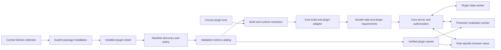

# Texstage plugin system design

**Status:** Draft for review, 5 November 2026. **Scope:** activity engines and custom
slide types, including presenter, projector and participant controls, in the first
plugin API release. All new commands, interfaces and file formats below are
proposed; Texstage 0.2.1.dev3 does not implement them.

Texstage should let an independently distributed package add a query engine or a
new kind of interactive slide without editing Texstage's source. A plugin can
provide both. The operator installs and enables the package separately; a lecture
selects its capabilities and carries the data needed to use them. Existing SQL,
SPARQL, Turtle, quiz and video workflows continue to work without plugin setup.

A central GitHub repository, provisionally named `texstage-plugins`, contains
maintained plugin sources, examples and a catalog for finding and installing
released plugins. Catalog-assisted installation is part of the first release.
It remains an explicit operation in the authoring or server environment, separate
from uploading a deck and from enabling the installed code.

The first release supports trusted plugins selected by the person operating the
authoring environment or server. It does not offer a sandbox for hostile plugin
authors. Student input remains untrusted. This distinction is particularly
important for custom UI code and Python build and state hooks.

## 1 Goals and boundaries

| The first release includes | Boundary |
| --- | --- |
| Activity engines | Browser worker evaluation, seed formats, input hints, result comparison and standard result summaries |
| Custom slide types | Authoring styles, build conversion, public and private item data, session state, and role-specific browser views |
| Interface controls | Controls belonging to a slide or its presenter panel, and participant input widgets |
| Independent distribution | Versioned portable Python wheels containing a declarative manifest, optional Python hooks, JavaScript, WASM, styles and notices |
| Central GitHub collection | Maintained plugin sources, searchable catalog, versioned release artifacts and explicit CLI installation |
| Operator controls | Inspection without importing plugin code, explicit enablement, exact locks, diagnostics, disablement and rollback |
| Existing materials | Existing LaTeX commands, engine aliases, bundles and course pins remain supported |

Global replacements for authentication, storage, the command dispatcher, arbitrary
HTTP routes and global presenter menus are outside API 1. Custom content uses the
host's authentication and message transport. Live PowerPoint support for new
types is also outside API 1; every type must provide a useful static representation
for PDF and PowerPoint. These boundaries still permit new interactive slide types
in the browser, rather than limiting the first release to evaluation engines.

A plugin never arrives inside a lecture bundle. Opening, uploading or presenting
a deck must not install a package, fetch executable code from a URL in the deck,
or enable an installed but unapproved package.

## 2 Starting point

The current implementation already has useful extension seams:

| Existing component | Current contract | Proposed treatment |
| --- | --- | --- |
| [Python engine registry](../../src/texstage/engines.py) | Seed extensions, MIME types and input tokens | Derive it from one validated catalog |
| [Browser engine registry](../../src/texstage/web/engines/index.js) | Module and WASM locations; `start`, `load`, `evaluate` | Generate browser descriptors from that catalog and retain built-in adapters |
| [Evaluator](../../src/texstage/web/stage/evaluator.js) and [worker](../../src/texstage/web/stage/evaluator-worker.js) | One worker per activity, timeout and reference evaluation | Keep host control of scheduling, leases and result validation |
| [Build types](../../src/texstage/build/types.py) | LaTeX records, live boxes, bundle entries and assets | Add a public, versioned build adapter instead of exposing internal modules |
| [Server types](../../src/texstage/server/types.py) | Messages, state, role views and archive hooks | Introduce a restricted public contract and host-owned persistence |
| [Live view](../../src/texstage/web/shared/live.js) | Mount, place, update and destroy content renderers | Add a versioned renderer adapter for each role |
| [Bundle format](../../src/texstage/build/bundle.py) | Formats 1 and 2; public `deck.json`, private `keys.json` | Retain old readers and add format 3 for external capabilities |

This proposal changes the earlier decision that all executable modules must ship
inside Texstage. It preserves the separation of executable packages from deck
data. The historical [content type design](content-types-design.md) and
[activity design](live-activities-design.md) describe the current system; their
internal hooks are not the public plugin API.

## 3 Architecture and ownership



Texstage owns compilation orchestration, bundle validation, identity and roles,
session lifecycle, message validation, persistence, transport, evaluation leases,
timeouts and static fallback presentation. A plugin owns its domain semantics and
the declared views of its content. The host derives a single immutable runtime catalog
at startup; plugins cannot mutate the registry or replace a built-in capability.

| Component | Ownership |
| --- | --- |
| Core framework | Compilation, bundle validation, presentation/navigation, identities, permissions, persistence, evaluation jobs and the extension SDK |
| Bundled features | Existing SQL, SPARQL, Turtle, quizzes and video remain included; adapters preserve their commands and behavior |
| External plugin | Adds an engine, a content type, or both through the SDK; installation and enablement are separate operator actions |
| Ordinary LaTeX package | Supplies a theme, notation or static layout; it does not become a Texstage plugin merely because it is a `.sty` file |

There is no one-to-one mapping between plugins and styles. An engine can use the
existing `activity` environment with no new style. A custom type can use the core
authoring bridge or provide one or more convenience styles. A plugin's style is
its authoring interface, not its complete implementation. Loading a style never
installs or approves Python/browser plugin code.

The `lecture-tools` package remains responsible for course assembly, notebook
workflows, checks and DBIS styles. It can pass an explicit plugin lock to Texstage,
but neither it nor a course bundle grants server permission to load a plugin.
No existing course is migrated or repinned by installing the plugin-capable host.

Built-in engines and content types stay in the Texstage distribution. Their
adapters use the normalized catalog contracts, while reserved core descriptors
remain available without external enablement. Moving SQL or SPARQL into a
separately installed wheel is not a prerequisite and would require a separate
compatibility decision.

## 4 Distribution and discovery

### Package contract

API 1 distributes each plugin release as one portable `py3-none-any` wheel used
unchanged on every supported authoring and server platform. It may contain Python
source, JavaScript, browser WASM, LaTeX and data; it must not contain native Python
extensions, OS-specific executables or platform-dependent generated resources.
Validate the contents as well as the wheel tag. This is an explicit API 1 scope
restriction, not a claim that all wheels are portable. Python's wheel tags express
interpreter, ABI and platform compatibility.
([Platform compatibility tags](https://packaging.python.org/en/latest/specifications/platform-compatibility-tags/).)

Native Python dependencies may have platform-specific wheels. Lock those
separately for each deployment target and include them in that environment's
runtime fingerprint. They must not cause the plugin's own released payload to
change. Plugins requiring their own native binaries need a later platform-variant
contract and are rejected by API 1 package validation.

A wheel advertises one plugin ID through the `texstage.plugins.v1` entry-point
group. Its entry point refers to a
factory using the standard `module:object` syntax:

```toml
[project.entry-points."texstage.plugins.v1"]
"org.example.teaching" = "texstage_teaching.plugin:create_plugin"
```

The wheel also contains `texstage-plugin.json` in its `.dist-info` directory.
This is a Texstage-specific metadata file, not an executable entry point. The SDK
build helper writes it into the wheel and includes it in `RECORD`. Standard entry
points refer to Python objects, so a JSON filename must not be disguised as an
entry-point target. The packaging specifications define both the entry-point
format and the distribution's installed metadata and file inventory.
([Entry points](https://packaging.python.org/en/latest/specifications/entry-points/),
[installed project metadata](https://packaging.python.org/en/latest/specifications/recording-installed-packages/).)

Discovery reads installed distribution metadata and the JSON file directly. It
does not call `EntryPoint.load()`, import the plugin's package, use an import-based
resource lookup, or execute its factory. Missing metadata is an inspection error;
there is no fallback that imports a plugin to discover its manifest. Python hooks
are loaded only for an explicitly enabled plugin, inside the appropriate worker.
An engine-only plugin needs no Python hook execution at runtime.

Installing a Python package is already a trust decision. Inspection without
imports does not make an arbitrary wheel safe to install. Deployment uses a
separate environment with reviewed wheels and locked dependencies. Runtime
discovery never invokes pip. Editable installs are a developer-only mode, visibly
marked as such, and cannot satisfy a production lock.

### Identity and collisions

Plugin IDs use a lowercase namespace, for example `org.example.teaching`.
Capability IDs include that prefix, for example
`org.example.teaching.coordinate-plane`. Ownership of a name is not proof of
publisher identity. Installation provenance and operator review establish trust.

The `org.texstage` namespace and the existing short names `sql`, `sparql`,
`turtle`, `quiz`, `video` and `activity` are reserved. Built-in names retain their
current meanings. Two enabled providers of the same ID are a configuration error,
regardless of installation order. No plugin can shadow a built-in or silently
replace another provider.

API 1 supports one installed version of a plugin distribution per host
environment. Courses requiring different versions use separate environments or
server instances. Cross-plugin runtime imports are excluded from API 1; a plugin
packages its browser dependencies or uses the versioned host SDK.
Declarative evaluation bindings may refer to another approved provider's engine
through the core job service. That is not a Python or JavaScript import of the
other plugin, and both providers must appear in the bundle's resolved requirements.

### Manifest example

This abbreviated example provides both extension kinds. The full schema also
requires descriptions, resource inventory, schema resources and license notices;
the SDK generates the inventory and validates the package before distribution.
Schemas cover engine options and every custom type's public/private item data,
state, message payloads and role views.

```json
{
  "manifest_version": 1,
  "id": "org.example.teaching",
  "version": "1.0.0",
  "plugin_api": 1,
  "latex_namespace": "teaching",
  "latex_exports": {"environments": ["teachingcoordinateplane"], "commands": []},
  "capabilities": {
    "engines": {
      "org.example.teaching.distance": {
        "engine_api": 1,
        "module": "web/distance.mjs",
        "seed_types": {".json": "application/json"},
        "input": {"mode": "code", "label": "coordinates", "tokens": [","]},
        "canonical_format": "distance-result-v1",
        "summary_kinds": ["select", "text"],
        "state_policy": "fresh-per-submission"
      }
    },
    "content_types": {
      "org.example.teaching.coordinate-plane": {
        "content_api": 1,
        "latex_packages": ["latex/texstage-teaching-coordinate-plane.sty"],
        "build_hook": "coordinate_plane",
        "state_hook": "coordinate_plane",
        "state_schema": 1,
        "evaluations": {
          "distance": {"engine": "org.example.teaching.distance"}
        },
        "views": {
          "presenter-overlay": "web/plane-overlay.mjs",
          "presenter-controls": "web/plane-controls.mjs",
          "projector-overlay": "web/plane-overlay.mjs",
          "participant-input": "web/plane-participant.mjs"
        },
        "messages": {
          "submit-point": {
            "from": ["participant"],
            "revision_policy": "latest",
            "schema": "schemas/point.json"
          },
          "reveal": {
            "from": ["presenter"],
            "revision_policy": "exact",
            "schema": "schemas/empty.json"
          }
        },
        "fallback": "static-slide"
      }
    }
  }
}
```

All resource paths are relative to the plugin's declared package root. Absolute
paths, parent traversal, symlinks, URL resources and resources owned by another
distribution are rejected. JSON schemas use only bundled local references;
validation never retrieves a schema from the network. The factory can return
implementations only for hooks already declared in this manifest.

The host rejects unsupported manifest or API majors and unknown execution-related
fields. Optional descriptive metadata has an explicitly extensible namespace. Package
versions, plugin API versions and result or state schema versions are separate:
changing a package patch number is not evidence of compatible result semantics.
The manifest's package version must match its distribution metadata. The wheel's
`Requires-Dist` declares its minimum Texstage version and Python dependencies;
catalog validation separately checks the API majors it actually requires.
The existing `texstage.api.API_VERSION` remains the course integration facade and
does not indicate support for plugins.

### Central GitHub collection

The proposed `texstage-plugins` repository has two responsibilities: maintain
plugin source packages and publish the discovery catalog. Each plugin remains a
separately installable wheel with its own version and release cycle. Installing
one plugin does not install the whole collection or require cloning its source.
Community plugins can either contribute source to this repository or retain
their own repositories and submit a catalog entry through a pull request.

```text
texstage-plugins/
  catalog/index.json                 # generated search index
  catalog/plugins/<plugin-id>.json   # release records and ownership
  catalog/schemas/catalog-v1.json
  plugins/<plugin-name>/             # pyproject.toml, source, tests, notices
  examples/<plugin-name>/            # synthetic decks and seed data
  docs/                             # author and maintainer guides
  .github/workflows/                 # validation and release workflows
```

The repository README provides a browsable plugin list generated from the same
records as the CLI. Entries identify the plugin ID, Python distribution, purpose,
engine/type capabilities, maintainer, license, documentation, source repository
and source subdirectory. Each version records its source commit, required
Texstage/Python/API versions, tested platforms, conformance results, the portable
wheel filename and URL, its SHA-256 value and provider payload digest. Source
ownership and maintenance status are visible; a listing is not a guarantee of
code quality or suitability for every server.

Publish wheels and release notes through GitHub Releases, using a per-plugin tag
such as `teaching-v1.0.0`. GitHub supports downloadable release assets. Enable its
immutable-release setting for the maintained collection so published asset bytes
and release tags cannot be replaced. Still verify the recorded hashes on every
download; a tag or a link labelled "latest" is not an artifact identity.
([GitHub Releases](https://docs.github.com/en/repositories/releasing-projects-on-github/about-releases),
[immutable releases](https://docs.github.com/en/code-security/concepts/supply-chain-security/immutable-releases).)

Catalog schema version 1 is separate from the plugin manifest/API versions. A
catalog update resolves the configured repository to a full commit ID, validates
its bounded JSON records and caches that snapshot. It reads metadata without
importing code or evaluating repository scripts. Keep the remote discovery
catalog distinct from the validated runtime catalog of installed, enabled
packages. Updating the former does not alter the latter.

The Texstage distribution supplies the default catalog location. An operator can
configure one alternative catalog or institutional mirror per profile; decks
cannot change that setting. Locks retain the catalog location, full commit and
selected entry/artifact digests as provenance, without credentials. Local wheel
installation remains possible without any catalog entry. A running presentation
never needs GitHub access. Cached records and wheels support explicit offline
installation; an absent dependency produces an error rather than a network
fallback in offline mode.

Maintainers review new IDs, ownership transfers and releases. Catalog CI checks
schema validity, reserved names, duplicate IDs, artifact hashes, manifest
agreement, package contents, licenses and the advertised conformance results.
Plugin execution tests use disposable CI jobs with no publishing credentials;
release publication runs separately from reviewed commits. Branch protection
and designated reviewers guard catalog and release configuration. Membership
does not grant runtime enablement, and hashes do not replace maintainer trust.

Build and test release artifacts before adding their catalog record. Publish the
completed release, then merge the entry with its verified URLs and hashes.
Preserve old version records for reproducibility. Mark a problematic version as
withdrawn, with a reason and replacement guidance, instead of reusing its version
or replacing its files. Refreshed clients block new installations of withdrawn
versions by default; existing sessions remain unchanged until the operator acts.
Offline clients show their snapshot age and cannot claim knowledge of later
withdrawals. Catalog signing and federated registries can follow separately.

## 5 Installation and enablement

These are proposed commands. The package and version in the example are fictional.

```sh
texstage plugins catalog update
texstage plugins search coordinate
texstage plugins info org.example.teaching
texstage plugins install org.example.teaching==1.0.0 --write-requirements plugin-requirements.txt
texstage plugins list
texstage plugins inspect org.example.teaching
texstage plugins enable org.example.teaching --data ./demo-data
texstage plugins lock --data ./demo-data --output texstage-plugins.lock.json
texstage build talk.tex --output-dir ./demo-out --data ./demo-data --plugins-lock texstage-plugins.lock.json
texstage plugins check ./demo-out/talk.bundle.zip --data ./demo-data
texstage serve ./demo-out --data ./demo-data
```

`search` and `info` use the cached catalog and show compatible versions,
capabilities, maintenance status and provenance; `list` and `inspect` describe
installed packages. Catalog refresh is explicit. If no snapshot is cached, the
CLI explains how to fetch one without installing anything.

`install` accepts an exact plugin version, selects its portable catalog wheel,
and checks its identity and hash. It resolves dependencies against the selected
environment's host and existing pins, reports planned changes and records the
complete pinned dependency artifacts for the selected platform/Python target in
`plugin-requirements.txt`. Deployment on a different target uses its own resolved
requirements file; this command does not claim to generate a universal Python
environment lock. It must not silently upgrade Texstage or an existing pinned
dependency to satisfy a new
plugin. Conflicts require a revised environment plan. Delegate resolution and
installation to the selected interpreter's pip CLI; do not build another Python
package manager or call pip's internal API.

Resolve only wheels from the catalog's exact plugin URL and operator-configured
dependency sources. Record and verify hashes for the complete dependency closure
before installing through `--require-hashes --only-binary=:all:`. Source builds,
floating Git branch installs and repository setup scripts are not part of this
convenience command. The pip documentation defines dependency resolution reports
and the all-dependency requirements of hash-checking mode.
([pip install](https://pip.pypa.io/en/stable/cli/pip_install/),
[hash-checked installation](https://pip.pypa.io/en/stable/topics/secure-installs/).)

The command operates on an explicitly selected, inactive authoring/server
environment. Installation failures leave no enablement or plugin-lock update;
package installation itself is not transactional, so restore a failed
environment from its prior requirements lock before using it. Upgrades use a
separate environment and retain the old one for rollback. Managed deployments
can install directly from the artifact lock, then continue with inspection,
enablement and plugin locking:

```sh
python -m pip install --require-hashes --only-binary=:all: -r plugin-requirements.txt
```

`inspect` reports the distribution, version, computed payload digest, requested
hooks, role views, dependencies, licenses and compatibility. `enable` shows that
report and records an operator decision for the exact ID, version and payload
digest. Noninteractive enablement requires all three to be supplied explicitly;
an ID alone cannot silently approve whatever a later installation provides.

Enablement belongs to an explicit authoring profile or server data directory,
outside the lecture bundle. A local lecturer may operate their own profile. On a
hosted server, only the operator using its CLI/configuration can enable plugins;
ordinary presenter credentials and participant PINs grant no installation rights.
There is no remote installation endpoint in API 1.

An author needs the plugin to build its content. The presentation server needs
the same approved runtime plugin to serve its assets and state hooks. Presenter
and participant browsers load the approved assets from that server and require no
separate installation. Installing in the author's environment does not configure
a hosted server automatically.

Production environments are read-only while serving. Worker startup rechecks the
approved provider fingerprint before loading a factory, uses the selected
environment's Python in isolated mode, and does not add a course directory or
ambient PYTHONPATH to its import path. Browser assets come from the verified
snapshot. Replacing Python files or dependencies in an active environment is an
unsupported upgrade procedure, even when the package version is unchanged.

`plugins catalog update`, `search`, `info`, `list`, `inspect`, `check` and manifest
validation execute no plugin factory. `plugins test` is a separate explicit
developer operation that executes
the selected plugin in a disposable test profile. Enabling or disabling a plugin
changes the next startup configuration; API 1 does not hot-reload a running
lecture. Operators drain sessions before upgrading or restarting an instance.

## 6 Locks and bundle compatibility

Two locks have different jobs:

| Lock | Records |
| --- | --- |
| Python requirements with hashes, per deployment target | The exact host, the portable plugin wheels and the platform/Python-specific dependency artifacts |
| `texstage-plugins.lock.json` | Selected plugin and capability IDs, versions, payload digests, API versions, result/state schema identities, and catalog provenance when used |

The plugin lock is safe to commit with teaching sources: it contains no presenter
keys, student responses, installation paths or private package-index credentials.
It records requirements, not permission to enable code. A build verifies it
against the installed packages and the selected local profile before compiling.
It never substitutes a newer compatible-looking version or edits the lock.

The same plugin wheel and portable plugin lock are used when a lecture is built
on Windows and served on Linux, or conversely. The two machines may use different
Python dependency artifacts and therefore different runtime fingerprints. A new
session resolves its fingerprint on the server; bundle preflight compares the
portable plugin requirements, not the author's runtime fingerprint. Resuming an
existing session on another environment still requires an exact runtime match or
an explicit migration; portability of a deck is not portability of saved runtime
state.

For example, a format-3 bundle contains a requirement like the following. This
is an excerpt; the digest label stands for the complete computed SHA-256 value.

```json
{
  "format": 3,
  "requires": {
    "plugin_api": 1,
    "plugins": [
      {
        "id": "org.example.teaching",
        "version": "1.0.0",
        "payload_sha256": "<64 lowercase hexadecimal digits>",
        "engines": {
          "org.example.teaching.distance": {
            "api": 1,
            "canonical_format": "distance-result-v1"
          }
        },
        "content_types": {
          "org.example.teaching.coordinate-plane": {
            "api": 1,
            "state_schema": 1
          }
        }
      }
    ]
  }
}
```

The payload digest is SHA-256 over the canonical manifest and a sorted inventory
of publisher-owned runtime files and their SHA-256 digests. Include Python hook
code, browser modules, WASM, schemas and styles; exclude generated bytecode and
installer-local bookkeeping. The manifest and its digest are not members of the
file inventory, avoiding a self-referential hash. The SDK specifies the canonical
byte encoding and ships cross-platform test vectors. Wheel archive hashes remain
in the Python lock; ZIP timestamps do not define runtime identity. Dependency versions and
the relevant host API versions are recorded in the resolved environment report.
A digest identifies selected bytes; it does not certify their publisher or safety.
The portable-wheel restriction makes this payload digest equal on Windows and
Linux without omitting executable files from verification. Platform-variant
plugin binaries cannot be accepted merely because they claim the same version.

Distinguish the portable provider payload digest from a resolved runtime
fingerprint. The latter also covers the selected capability/schema identities,
the host executor/SDK build and the resolved dependency artifact identities.
Persist that environment report with session metadata. Updating a dependency or
host adapter can change behavior even when the plugin's own files are identical;
it must invalidate runtime caches and require explicit session compatibility
handling too.

### Format 3

A deck requiring an external engine or content type uses bundle format 3. It
records each resolved provider, capability, exact version, payload digest, API
major and result/state schema. The requirement record participates in the bundle
ID. It contains no Python, JavaScript, WASM or plugin styles. Those remain in the
installed distribution and server asset cache.

Use format 3 rather than adding requirements that an old format-2 reader might
ignore. Old servers reject format 3 with an upgrade diagnostic. New servers keep
reading formats 1 and 2. Builds using only existing capabilities keep format 2 by
default, preserving existing bundle behavior. Explicitly opting into a plugin
lock can produce format 3 even for built-in-only content.

Before a live session starts, resolve all requirements and verify the supported
views for its roles. A missing, disabled, incompatible or altered provider blocks
that live session with a specific explanation. It must not quietly become a
different engine or an apparently successful activity with no renderer. The
static PDF and static PowerPoint export remain usable independently. A new
server may offer an explicitly labelled static-only preview of an incompatible
bundle; it must not accept participant submissions in that mode.

A session keeps its resolved catalog generation and fingerprints for its whole
lifetime. Results and reference caches include the bundle, activity, engine
fingerprint, seed/configuration identity and canonical format. A plugin update
must never reuse results computed by another implementation. Legacy activity
keys remain unchanged for legacy bundles; new result messages carry the runtime
namespace separately from the existing result key.
The server accepts new results only from the current presenter lease holder and
for the expected job, activity and runtime fingerprint. A delayed response from
an earlier worker or catalog generation cannot overwrite current results.

## 7 Activity engine API

Authors keep the existing `texactivity` environment and select the qualified
engine ID through its `engine` option. For example, the fictional distance engine
could accept a coordinate pair and return its distance from an origin stored in
the seed:

```latex
\begin{activity}[id=distance-a,input=code,
    engine=org.example.teaching.distance,
    seed=distance.json,reference=distance.txt]
  \prompt{Enter the coordinates 3,4 to find their distance from the origin.}
\end{activity}
```

Here the seed could contain `{"origin": [0, 0]}` and the reference file the input
`3,4`, whose result is `5`. The host validates seed/options against the provider's
schema and derives input labels, token buttons and editor hints from its
descriptor. API 1 engines take the standard text/code activity input; a spatial
widget or a different interaction model uses the custom slide type API.

Keep the recognizable `start`, `load` and `evaluate` model, adding explicit
resource access, state lifetime and cleanup. These are proposed signatures:

```javascript
export const engineApi = 1;
export async function start(context) { /* load library from supplied assets */ }
export async function load(library, seed, options) { /* fresh exercise state */ }
export async function evaluate(state, text, context) { /* EvaluationResult */ }
export async function dispose(state) { /* release database or WASM handles */ }
export async function stop(library) { /* optional worker shutdown cleanup */ }
```

The host resolves and verifies the asset inventory. It supplies approved resource
bytes and compiled WASM modules to the worker; `context.asset(name)` reads that
inventory, not a URL. JavaScript libraries must be included in the declared module
graph. Multiple WASM assets and engines with no WASM are supported. There is no
requirement that every plugin mimic sql.js's loading convention.

The worker initializes a library once, but calls `load` for a fresh state before
each submission or reference, then calls `dispose`. The host controls that
sequence. An engine must not retain submission-dependent state in its library or
module globals. Built-in adapters may preserve their existing shared read-only
state where equivalence tests establish unchanged behavior. External API 1
engines use the fresh-state contract.

This permits a future writable SQL teaching engine to execute a student's script
in a disposable database. Such an engine has a new ID and documented rules. It
must not change the meaning of the existing read-only `engine=sql` alias.

### Result contract

`evaluate` returns `status` with one of `ok`, `syntax`, `error` or `refused`.
Failures have bounded plain-text diagnostics. A successful result provides a
canonical string and a summary of kind `select`, `ask`, `graph` or `text`.
Optional canonical rows support the host's existing bag comparison. An engine
without row comparison still supports equality grouping, and the UI states that
row-level comparison is unavailable.

The SDK defines the complete JSON schemas for those summaries and supplies
canonicalization helpers. Plugin-specific HTML, executable expressions and DOM
objects are not valid results. Richer interaction uses the content type API.
The host validates and bounds outputs before storing or displaying them. It owns
result keys and reference comparison; a plugin cannot mark a submission as a
correct reference through a claimed key. New results are namespaced by the
resolved engine fingerprint and canonical format. A format change invalidates
comparison caches even when the package version remains similar.

### Execution limits

The host queues work under the existing presenter evaluation lease and supervises
the worker. Initial defaults are 30 seconds for library initialization and
2 seconds for loading state, evaluating and disposing of a submission together.
The operator can set bounded profiles for larger engines; a deck cannot raise
its own limits.
Terminate the worker after a timeout, then reinitialize and evaluate references
before accepting further results. Repeated failures disable that activity for
the session with an explanation while ordinary slide navigation continues.

Input, seed, output and asset sizes have host limits. API 1 initially retains the
current 2 MiB seed and 2000-character text submission limits for standard code
activities. New summary payloads fit within 12 KiB of UTF-8 JSON, including
comparison information; diagnostics are bounded separately. Existing legacy
limits remain on the legacy path. Browser workers do not provide a portable hard
memory quota, so browser memory behavior is an explicit release test, not a
promised sandbox property.

## 8 Custom slide type API

A content type can provide all four layers below. A static visualization can omit
state hooks and participant input. A participant-interactive type must declare
its input messages, validation schemas and `participant-input` renderer.

| Layer | Public plugin contract | Host responsibility |
| --- | --- | --- |
| LaTeX | Optional namespaced styles and a generic core bridge for item records and live-box geometry | Style resolution, build mode, unique IDs, record escaping and frame/overlay mapping |
| Build | `prepare(record, context) -> PreparedItem` | Input/schema validation, asset naming, public/private split and bundle writing |
| Session state | Initialization, event transition, evaluation effects and audience-view hooks | Authentication, durable receipts/jobs, sequencing, transactions, storage and transport |
| Browser view | `mount`, `update`, `place`, `destroy`, with an explicit surface ID | Surface allocation, role context, navigation, lifecycle and error fallback |

The Python factory returns an SDK `PluginV1` value with `build_hooks` and
`state_hooks` mappings. Their keys match the manifest's hook names; no undeclared
hook is accepted. State-hook objects implement the three methods below. The
factory receives no application object and cannot register global callbacks
through this API. Engine-only providers use their static browser descriptor and
do not require a factory call.

### Authoring and static outputs

Plugin LaTeX styles load through search directories supplied by the selected
profile. They are not installed into a global TeX tree or copied into existing
course style snapshots. Add the record bridge to `texstage.sty`; preserve the
existing four generic package names and current commands.

Plugins with styles declare a lowercase ASCII `latex_namespace`. Style basenames
use `texstage-<namespace>-<name>.sty`; exported commands and environments start
with that namespace, as in `teachingcoordinateplane`. A profile rejects duplicate
namespaces or case-insensitive duplicate style basenames before compilation.
Public command/environment names are listed in `latex_exports` and checked for
collisions across enabled plugins and core exports. The four core style basenames
and their namespaces are reserved. Plugins must define new commands, not silently
redefine core or another provider's commands.

Use explicit search directories and the TeX recorder's loaded-file list to check
that each declared plugin style actually loaded from the approved package with
the expected digest. A same-named local file or stale TeX-tree copy produces a
diagnostic instead of silently compiling against different code. Ordinary TeX
dependencies remain available through the normal TeX distribution. A plain TeX
editor can compile static output after the author explicitly configures those
style directories; reproducible Texstage builds perform the manifest and loaded
file checks. Neither path interprets `\usepackage` as approval to execute Python
or browser hooks.

The bridge emits a new versioned plugin record containing the qualified type,
item ID, declared public/private data references and live-box association. String
fields use the core's defined escaping or encoding rather than concatenated raw
JSON into a delimiter-based TQZ record. The host owns the record grammar and
rejects unknown IDs, undeclared types and malformed geometry.

Expose that bridge as the core `texstagepluginbox` environment: its keys are
`type`, `id`, `public` and optional `private` data-file references, followed by
width and height arguments and a static LaTeX body. It records geometry in
present mode and renders that body in every mode. Build hooks receive the
declared JSON data through the host, never arbitrary paths from a participant.
Convenience styles can use core helpers to emit equivalent encoded records and
generated data resources for inline options. The prototype must specify and test
this record grammar before the authoring API is frozen.

A plugin may wrap the bridge in a convenient environment. This is a complete
proposed `plane.tex` authoring example for the fictional teaching plugin:

```latex
\documentclass{beamer}
\usepackage{texstage-teaching-coordinate-plane}
\begin{document}
\begin{frame}{Place a point}
  \begin{teachingcoordinateplane}[id=point-a, xmin=-2, xmax=2,
      ymin=-2, ymax=2, answer={1,-1}]
    Mark the point one step right and one step down from the origin.
  \end{teachingcoordinateplane}
\end{frame}
\end{document}
```

After the plugin is separately installed, enabled and locked as in section 5:

```sh
texstage build plane.tex --output-dir ./plane-out --data ./demo-data --plugins-lock texstage-plugins.lock.json
```

Its handout shows the prompt and coordinate axes. Its solutions view can mark the
answer. Its present view declares the live area and has a static fallback. The
phone can display an interactive coordinate grid, the projector aggregated
points, and the presenter controls for opening, closing, clearing and revealing.
Private answer data belongs in `keys.json`, not participant configuration.

The build hook returns `PreparedItem(public, private, assets, evaluations,
diagnostics)` using SDK value types; `evaluations` defaults to an empty mapping.
Each evaluation binding supplies a declared seed resource, schema-validated
options and optional private reference inputs for a manifest-declared engine.
Asset declarations distinguish public and presenter-only data.
The host reads only declared input resources, assigns content-hashed bundle
paths, and checks declared data MIME types against a core allowlist. New extension
data assets cannot use HTML, JavaScript, WASM or active SVG types; ordinary static
images use the existing image path. A plugin cannot expand that allowlist through
its manifest. Plugin code or styles cannot be smuggled into the bundle as
executable resources. The authoring process and TeX sources remain trusted inputs,
as they are today.

Every type must document and test handout, solutions, live browser, static PDF
and static PowerPoint output. API 1 uses static slide images for plugin content
in PowerPoint; it does not automatically extend the Office add-in.

### State and messages

Use SDK hooks with JSON-compatible values rather than passing internal `Call`,
`Session`, `Book`, database connections or request objects to plugins:

```python
def initial_state(item, context): ...
def transition(state, event, context): ...  # -> Transition(new_state, effects)
def view(state, audience, context): ...    # audience: role, surface, optional actor ID
```

The command envelope contains type, item, operation, item epoch, request ID,
expected revision and payload. An epoch identifies the current reset of an item;
a revision orders committed changes within that epoch. The host derives actor,
role and session from the authenticated connection. The manifest declares sender
roles, payload schemas and a `revision_policy`: `exact` rejects a mismatched
expected revision; `latest` applies an additive submission to the current state.
Both policies enforce the current epoch and the activity's open/closed rules.

Authenticate and authorize every request, including retries. For an existing
receipt with the same actor, item, epoch and request ID, return the original
outcome without rerunning the transition or checking its old expected revision
against today's revision. Reusing that ID with a different operation or canonical
payload/envelope digest is an error. A fresh request passes active-item,
participation, schema, size and rate checks before its hook runs. A closed or
reset item cannot accept an old request as a new submission.

Context contains the relevant item configuration, the event's host timestamp,
an opaque session-scoped actor ID, role, epoch and state revision. Participant
display names are not supplied by default. The host serializes commands,
navigation and evaluation results for each item. Invoke the hook on a snapshot
outside the database write transaction; it must have no external side effects.
Hooks are deterministic for their supplied state, event and context, using the
provided timestamp rather than reading a new wall clock or ambient random state.
Validate the output, then compare the snapshot revision before committing. A
stale snapshot cannot overwrite newer state.

Events have a host-assigned kind: `command`, `activate`, `deactivate` or
`evaluation.finished`. Internal events use the `system` role; any originating
participant/presenter identity is separate immutable metadata. Clients cannot
choose event kinds or claim that role. `initial_state` creates the first state
of an item and the fresh state for a host reset; restoring persisted state does
not call it again.

Core persistence keeps three records together:

| Record | Required contents |
| --- | --- |
| Item state | Session, bundle, type, item, runtime fingerprint, state schema, epoch, revision and JSON state |
| Request receipt | Actor and request identity, canonical request digest, accepted/refused outcome, resulting revision and response |
| Durable action queue | Pending evaluation/cancellation actions, each identified by the accepted request/event and effect index |

Commit the validated state change, receipt and pending actions in one database
transaction. Send the acknowledgement and publish role views only after commit.
After authentication and schema checks, terminal participation-policy, revision
and domain refusals also store a receipt without changing state. Authentication
and schema failures are rejected before plugin execution. Transient service
unavailability is explicitly nonterminal and may be retried with the same ID;
it is never acknowledged as an accepted operation. Retain receipts throughout
the resumable session; enforce size/count limits rather than silently evicting
the records needed for deduplication.

If a process dies before commit, the request can be evaluated again with no
committed effect. If it dies after commit but before acknowledgement, a retry
returns the saved receipt. If it dies before dispatching a committed action, the
durable queue dispatches it after restart. Delivery may repeat; effect consumers
deduplicate by their durable action ID. This guarantees one accepted state
transition per request, not exactly one execution of worker code.

Browser dispatch retains the same request ID and envelope until acknowledged.
On reconnect it obtains a fresh audience-specific snapshot, including epoch and
revision. Host activation/deactivation events do not implicitly clear state.
Item reset is a core operation in the host's presenter controls and uses the same
request/receipt protocol. It advances the epoch atomically, replaces state and
invalidates outstanding jobs; old requests and results cannot populate the new
epoch. Reset itself has a
durable request receipt, so a retry of that reset returns its saved outcome.

API 1 effects are limited to the evaluation operations below. View publication
is an automatic host action after state commits. Hooks cannot introduce routes,
change permissions, register tables or send arbitrary WebSocket messages.
Existing sessions resume only with a matching runtime fingerprint and state
schema; upgrades use a new session or a separately reviewed migration. Archives
retain data and static representations independently of installed plugin code.

Python state hooks run in a dedicated spawned worker process per enabled plugin,
with bounded JSON requests and responses. The server owns state and storage;
the child receives only a job snapshot. Initial defaults are 10 seconds for
startup and 250 milliseconds for a state/view operation, with bounded operator
overrides. Kill and replace a timed-out worker; reject its in-flight transition.
Do not try to terminate a Python thread executing an arbitrary hook. Queue and
payload limits prevent one plugin from accumulating unlimited work.

Process separation provides failure containment, not an operating-system security
sandbox: installed Python remains trusted code with the service user's OS
privileges. Hooks must perform bounded state transformations, without evaluating
student programs or doing external I/O. Expensive student evaluation belongs in
the presenter worker. The old phrase that the server runs nothing is therefore
refined to: the server runs trusted application/plugin state logic, never student
query programs as part of this API.

### Evaluation jobs from custom slides

The manifest's `evaluations` mapping declares named engine bindings. The build
hook resolves their seeds, options and private reference inputs in `PreparedItem`.
Resolution includes every referenced provider in the portable plugin lock and
bundle requirements. A binding may select a built-in engine or an approved
external engine; the content type never imports its implementation.

State transitions can return these SDK effect values:

| Effect | Meaning |
| --- | --- |
| `Evaluate(binding, correlation_id, text)` | Queue one evaluation against a declared binding using the standard text/code engine input |
| `CancelEvaluation(correlation_id)` | Cancel the current item's pending job with that correlation ID; an already terminal or absent job is a no-op |

The coordinate-plane type can translate the submitted point into `"1,-1"` and
request its `distance` binding for supplemental feedback. Correct point placement
compares both coordinates with the private answer; equal distances alone do not
make two points equivalent. The type records the pending correlation ID in its
new state. Bindings and correlation IDs are item-scoped; the host supplies session,
actor, epoch, submitted revision, provider fingerprint and an opaque job ID. A
correlation ID identifies one logical job within the item's epoch and cannot be
reused for another input. The accepted request's receipt maps correlations to
job IDs. Plugins and phones cannot choose an evaluator connection, seed URL,
reference answer, different item or different server session in an effect.

Allocate the job ID and persist its initial record with the transition, receipt
and action queue, before acknowledging the command. Its states are
`queued`, `leased`, `succeeded`, `failed` or `cancelled`. With no presenter holding
the evaluation lease it stays queued with an explanatory status; it must not
report success. Queue limits refuse excess work before accepting the associated
transition. The existing presenter evaluator executes the job under host budgets
and reference comparison rules. Lost leases may cause bounded re-execution of a
job; a lease generation fences late responses from old evaluators.

The host accepts a terminal result only for the current job, epoch, lease
generation and runtime fingerprint. In one transaction it saves the terminal
outcome and queues an internal `evaluation.finished` event with job ID,
correlation ID, binding, originating actor, submitted revision, status and bounded
result/error data. This event has a durable identity and uses the same serialized
transition/receipt mechanism. Participant messages cannot impersonate internal
events. The hook updates feedback only if the correlation is still relevant;
superseded submissions must not overwrite newer feedback.

Cancellation and completion race through the same durable job record: the first
accepted terminal outcome wins. Cancellation can end the logical job even if the
browser cannot stop immediately; subsequent output is discarded. Reset cancels
pending jobs and excludes all old-epoch events. Navigation alone preserves work;
the plugin's deactivation transition may request cancellation explicitly.
Delivered completion can repeat after a crash, but it changes state at most once.
This interface makes custom input widgets use the same queues, leases, limits,
private references and comparison rules as ordinary code activities.

### Browser views and controls

The manifest keys views by surface, not just role:

| Surface ID | Role | Placement |
| --- | --- | --- |
| `presenter-overlay` | presenter | Live area on the presenter's slide |
| `presenter-controls` | presenter | Separate content-specific control panel |
| `projector-overlay` | projector | Live area on the audience slide |
| `participant-input` | participant | Phone input and permitted personal feedback |

Overlay renderers are required for presenter and projector; the same module may
implement both. Controls are optional; participant input is required when the
type accepts participant operations. The host mounts a separate instance for
each `(item, surface)`, even when two surfaces use the same module. Each instance
receives its own container and explicit `context.surface` and `context.role`.
The server's `audience` argument includes that surface and, for personal views,
the authenticated actor. Projector views never inherit presenter data or controls.

`mount(container, context)` synchronously returns a renderer with
`update({epoch, revision, data})`, `place(rectangles)` and `destroy()`. The host
places overlay instances before their first update; rectangles are CSS-pixel
coordinates relative to that overlay container after slide scaling. It calls
`place` again on layout changes. Panel and phone layouts use their containers'
normal responsive layout and do not receive slide rectangles. Updates are full
audience-specific snapshots; the host suppresses stale revisions within an epoch.

Context also supplies language, item ID, a clock, an approved resource resolver,
an abort signal and `dispatch(operation, payload)`. Dispatch adds the current
epoch/revision and a request ID, retries the unchanged request until acknowledged,
and returns the durable receipt. It is disabled for projector surfaces; the
server still enforces every message's declared roles. A stale exact-revision
command needs a new deliberate operation after refresh, not an automatic rewrite
of the old request. The participant context contains no presenter key or private
answers. Render submitted text as text using the SDK's safe formatting helpers.

Views run as trusted same-origin modules, scoped to host containers; Shadow DOM
can isolate styling but is not a security boundary. A provider installed on the
presenter origin can execute code there. Role-specific view contracts and
schema validation prevent accidental over-sharing through the SDK, but cannot
make malicious provider code safe. UI exceptions are contained and replaced by
a static fallback with a presenter diagnostic. A main-thread infinite loop is
not recoverable by an exception handler; responsive rendering is a conformance
requirement and an operator trust consideration.

Require keyboard and touch input, focus cleanup, accessible labels, resizable
layouts and language fallbacks. On unmount the host aborts pending resource work
and invokes `destroy`; cleanup must be idempotent and remove listeners, timers
and subscriptions. A plugin cannot own global navigation, hotkeys or participant
authentication screens. Separate mounts must not share mutable UI state through
module globals, duplicate controls or submit twice.

## 9 Assets and browser policy

At enablement/startup, verify and snapshot the declared assets into an immutable
cache addressed by payload digest. Serve only paths in that inventory, with
fixed MIME types, `nosniff` and immutable cache headers. Reject altered files and
traversal rather than resolving arbitrary paths below site-packages. The browser
catalog contains host-resolved asset addresses; a deck cannot override them.

Use a core-owned evaluation-worker bootstrap with `connect-src 'none'`. Restrict
script loading to the approved local module locations, prohibit child workers
unless the host explicitly supports them, and allow only the WASM compilation
permission required by the selected engine. Do not treat `connect-src` as a
complete policy: CSP separately governs script and worker loading.
([CSP connection policy](https://www.w3.org/TR/CSP3/#directive-connect-src),
[CSP worker policy](https://www.w3.org/TR/CSP3/#directive-worker-src).)

The host loads declared binary/data assets before evaluation and transfers them
to the worker. No CDN scripts, engine-provided remote URLs, fetched imports from
deck data, service-worker installation or plugin-selected arbitrary origins are
part of API 1. Browser conformance tests must exercise imports, WASM startup,
failed network attempts and timeouts on the supported browser matrix, including
ordinary LAN HTTP where that remains supported. Hashes and cached asset names
are integrity controls, not a substitute for HTTPS on remote deployments.

All provider code remains operator-trusted. The browser worker and CSP protect
the evaluation workflow against unintended query behavior; they are not grounds
for executing an unreviewed plugin from a student's deck.

## 10 Errors and recovery

| Situation | Required behavior |
| --- | --- |
| Installed but disabled plugin | Inspectable metadata only; no factory import or assets advertised to a deck |
| Duplicate enabled ID or reserved alias | Reject configuration; never choose by discovery order |
| Missing or mismatched lock requirement | Explain the exact provider/version/digest mismatch before live presentation |
| Engine syntax or refused operation | Ordinary activity feedback; subsequent submissions still work |
| Engine timeout or crash | Terminate worker, rebuild seed/reference state, then retry later work within policy |
| Malformed engine output | Reject it as a plugin error; do not store an arbitrary result or render its markup |
| Python state hook failure | Preserve committed state, fail the request, restart or quarantine the worker |
| Renderer exception | Retain navigation and static slide; show the presenter a diagnostic |
| Runtime upgrade during an old session | Refuse fingerprint mismatch; keep the old environment for resumption or rollback |
| Plugin removed | Keep archived data; explain which live views are unavailable |
| Native/platform-specific plugin wheel | Refuse API 1 installation with the portable-wheel requirement; do not weaken bundle hash checks |
| TeX resolves an unapproved style copy | Fail the build with the actual and expected style locations/digests |
| Retried command after a server restart | Return its durable receipt; do not apply the transition or create jobs again |
| Result after reset, cancellation or lease replacement | Discard it unless its job, epoch and lease generation still permit acceptance |
| GitHub unavailable or catalog stale | Explain discovery/install limits; existing installations and live sessions continue without a catalog connection |
| Catalog artifact mismatch or withdrawn release | Refuse installation; never substitute another version or silently rewrite a lock |

Diagnostics include plugin/capability IDs, version, fingerprints and a correlation
ID. They exclude raw student submissions, reference answers and presenter secrets
by default. Troubleshooting exports are explicit and use synthetic reproduction
data wherever possible.

## 11 Implementation sequence

Both extension kinds and the GitHub collection belong to API 1. Prove the whole
authoring-to-phone path before broad changes to the bundled implementations.
The prototype is a release gate, not an engine-only first version.

| Stage | Changes | Completion evidence |
| --- | --- | --- |
| 1 Contracts and fixture packages | Add `plugins/manifest.py`, `catalog.py`, `policy.py`, `lock.py`, `assets.py` and `plugin_api/v1` schema/value types; specify portable packages, style ownership, requests, jobs, audiences and surfaces; scaffold independent engine and custom-type wheels | Schemas validate all examples; disabled packages are never imported; package, capability and style collisions are rejected; fixture inventories and hashes agree on Windows/Linux |
| 2 Complete prototype and recovery gate | Implement a minimal external-plugin path through `texstage.sty`, TQZ, format 3, state workers, durable receipts/action queue/jobs, evaluator routing and all four browser surfaces | Install an engine fixture and a separate coordinate-plane fixture bound to it; build on Windows and serve on Linux, then reverse; complete phone-to-engine-to-projector feedback, handout/solutions/PPTX fallbacks, lost acknowledgements, restart and reset races |
| 3 Bundled-feature integration | Derive existing engine/type descriptors from the runtime catalog; adapt evaluator and browser hosts while retaining legacy facades and formats 1/2 | Existing SQL/SPARQL/Turtle, quiz and video behavior, aliases, reference outputs and read-only SQL rules pass regression checks; old course integration imports remain lazy and no-plugin builds retain their format |
| 4 Contract hardening and SDK | Complete package validation, conformance runner, worker/renderer lifecycle, accessibility, browser matrix, resource limits, archives and developer/operator guides | Runtime and SDK acceptance cases pass; synthetic concurrent sessions meet measured budgets; startup, duplicate events, stale jobs, independent renderer mounts and rollback have reproducible checks |
| 5 GitHub collection and release | Establish `texstage-plugins` with maintained sources, examples, catalog/index, contribution guide and release CI; add refresh/search/info/install commands over the tested package contracts | Catalog acceptance cases join the completed runtime/SDK checks; versioned wheels install independently; hashes, dependencies, withdrawals and offline operation are verified; the API 1 release passes the full suite and includes both extension kinds and the collection |

Stage 2 must use installed wheels in separate environments, not source-path
injection or an editable checkout. Its custom type uses the engine in the other
fixture through the public job interface; this proves composition as well as the
two APIs separately. Failures at this gate revise the contracts before stage 3.
Keep prototype paths explicitly experimental until the full acceptance suite
passes; do not advertise stable API 1 merely because the example works.

Internal registries may remain as compatibility facades during migration, but
the final implementation has one runtime catalog rather than separately edited
Python and JavaScript tables. Existing `texstage.api` callers must continue importing without
discovering or executing plugins. Plugin profiles and locks are explicit inputs
to commands, not ambient changes triggered by importing Texstage.

For lecture-tools, add optional argument forwarding and documentation only when
the host API exists. Do not copy external plugin styles into its verified core
style snapshot. Validate the new pair in disposable course copies before a
separate course adoption change. Existing courses keep their current packages,
submodules, generated artifacts and environments.

## 12 Acceptance tests

1. **Independent installation:** build and install two fixture wheels, an engine
   and a custom type, in a fresh environment. Neither requires edits to Texstage.
   Install the same portable wheel bytes on Windows and Linux, with separate
   target dependency locks; verify equal provider payload digests and distinct
   environment fingerprints where dependencies differ. Build a bundle on each
   platform and serve it on the other. Reject native plugin binaries; test
   source-distribution to portable-wheel parity and complete resource inventories.
2. **No implicit execution:** import sentinels prove that listing, inspecting,
   checking, uploading a bundle and opening a disabled plugin's deck do not
   import its factory. Missing locks do not trigger network installation.
3. **Existing behavior:** preserve the current SQL/SPARQL/Turtle tests, aliases,
   canonical outputs, read-only SQL rules and legacy result handling. Existing
   format-1/2 fixtures and no-plugin builds remain compatible.
4. **Complete custom type:** author the coordinate-plane slide, build handout,
   solutions and PowerPoint fallback, open it on all three roles, submit by touch
   and keyboard, route evaluation through the separate engine fixture, reveal,
   reconnect, reset and export an archive. Test zero-style engines, the generic
   authoring bridge, multiple declared styles, command/filename conflicts and a
   stale local style shadowing the approved one. Exercise the full `plane.tex`.
5. **Authorization and privacy:** a participant cannot call presenter operations,
   forge an actor, change another session/item, obtain private answers before
   reveal, or enable a plugin. Projector views contain no private controls/data.
6. **Reproducibility:** mismatched versions, altered assets, conflicting IDs,
   incompatible API majors, changed result formats and stale browser catalogs
   produce explicit errors. Different implementations never share result caches.
7. **Isolation and recovery:** fresh submission state, oversized input/output,
   infinite evaluation, startup failure, worker crash, blocked network access,
   invalid JSON and duplicate requests leave host state consistent. Inject
   crashes before commit, after commit before acknowledgement, and after job
   completion before event delivery. A retried command produces one transition,
   one logical job and one applied completion. Reject request-ID reuse with a
   changed envelope. Replayed resets must not advance the epoch twice.
8. **UI lifecycle:** repeated navigation destroys old views and listeners;
   renderer failure preserves a useful fallback. Test accessibility, resizing,
   language fallback and role/surface separation in real browsers. Mount the
   same module on presenter overlay and controls simultaneously with separate
   instances; verify geometry, filtered data, dispatch permissions and cleanup.
9. **Operational limits:** run a synthetic multi-participant session and measure
   queue growth, reducer latency, memory, initialization and reference replay.
   Confirm or revise the proposed defaults before freezing API 1.
10. **Upgrade and rollback:** keep an old environment and session data, upgrade
    into a separate environment, reject mismatched resumption, then restore the
    old environment and resume without translating old state accidentally.
11. **Central collection:** build a maintained plugin, publish a test release,
    validate its catalog entry, discover it and install just that plugin into a
    disposable environment. Verify that installation does not enable it. Test
    duplicate IDs, unsupported catalog schemas, altered wheels, dependency
    conflicts, withdrawn versions, an unavailable catalog and complete offline
    installation from the cache. Snapshot updates must leave existing locks and
    running sessions unchanged. Exercise an externally maintained catalog entry
    as well as a package whose source lives in the central repository.
12. **Evaluation lifecycle:** start with no evaluator, reconnect a presenter,
    replace its lease, cancel while a result is in flight, reset, and deliver
    stale or duplicate results. Only the accepted job/epoch/lease can complete.
    Test two submissions by one participant finishing out of order and ensure
    older feedback cannot replace the current attempt. A phone cannot forge an
    internal result event or select undeclared engines, seeds or references.

These tests run against synthetic decks and disposable server data. Release
evidence records the exact host/plugin artifacts and supported browser versions.
A skipped browser, phone interaction or installed-wheel check is recorded as a
gap rather than treated as a passing test.

## 13 Tradeoffs and later extensions

Wheels fit the existing Python installation and locking workflow and allow the
build/state hooks needed by custom slide types. They also make provider code
fully trusted. A JS-only archive could be a later distribution option for engines;
it would not replace the first version's complete custom type contract.

Same-origin renderers permit close integration with the presenter and phone UI.
Running untrusted providers would require another design with separate origins,
an explicit message bridge and stronger OS/process isolation for Python. Treat
that as a different trust model, not a configuration flag that makes API 1 safe.

API 1 includes the GitHub collection and catalog-assisted CLI installation.
Installation stays operator-initiated, versions stay fixed per environment,
state migrations remain explicit and PowerPoint output is static for external
types. A web marketplace, federated catalogs, publisher/catalog signatures,
platform-specific plugin binaries, side-by-side versions, remote execution,
arbitrary renderer origins, global UI extensions and live Office integration can
follow the first release.

Before implementation is frozen, confirm the worker/renderer browser matrix,
measure the proposed resource budgets, and review the operator trust model for
shared institutional servers. The first milestone is the installed-wheel
prototype with both extension kinds, cross-platform deck exchange and durable
recovery. Use its evidence to settle the contracts before broad migration or an
API stability commitment.
