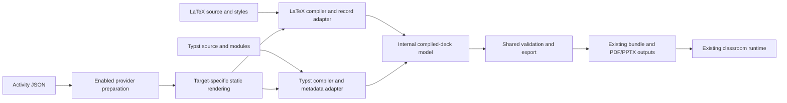

# Optional Typst backend: design

Status: proposed; no Typst backend is implemented by this document.
Date: 2026-11-08.
Companion: [implementation plan](typst-backend-plan.md).

This design was checked against TeXStage base `e7351a5` and plugin collection
base `1c5d922`, plus the pending database-example and language changes in their
working branches. Recheck these contracts before implementation. In particular,
the host currently accepts plugin manifest revisions **1 through 5**; prepared
authoring still returns format-1 LaTeX fragments. Those are separate versions.

## Decision and scope

Add Typst as an optional source backend in the existing TeXStage host. Both
source languages produce the existing classroom bundle and use the same server,
presenter, projector, phones, evaluator workers, submissions and scoreboard.
Keep the TeXStage name and code mirror arrangement.

The first deliverable is a four-slide prototype with ordinary content, a quiz,
SQL and a prepared B+ tree activity. It must work without a TeX installation.
Existing LaTeX commands, public Python APIs, package resources, course pins and
generated-course workflows retain their behavior. The backend must not be
needed to install TeXStage, present existing bundles or run LaTeX builds.

This is not a LaTeX-to-Typst converter, a new classroom server, an unrestricted
Typst presentation importer, or an automatic port of DBIS styles and TikZ.
Mixed-language fragments inside one source document, editable PowerPoint
objects, hosted compilation of untrusted source, and per-student plugin
language selection are outside the first release.

## Prototype that decides feasibility

Use a small synthetic lesson, “How a library finds a book.” Four authored slides
share coherent data without using any existing course files.

| Authored slide | Demonstration | Required result |
| --- | --- | --- |
| Introduction | A catalogue table, a formula, an image, two reveal steps and presenter notes | Two physical slide pages; correct step navigation and notes |
| Quiz | Single choice: which field uniquely identifies a book? Stable choice IDs; shuffling disabled in this fixture | Read, question and reveal phases; correct/wrong phone submissions and existing quiz scoring |
| SQL | Select available books from a small in-memory catalogue | Existing code editor, run/submit/review flow; a correct alternative query is accepted; writes including DROP remain refused |
| B+ tree | Insert a catalogue key into a small checked tree that requires a leaf split | Existing structured phone editor, repairs, partial credit, feedback, score publication, reset and worked solution |

Disable the quiz's automatic leaderboard slide in this fixture. The target is
four logical slides and seven present pages (2 + 3 + 1 + 1), with notes mapped
explicitly rather than counted as slides. Join through the presenter's existing
QR/PIN interface; a dedicated join slide is not part of this fixture. Record
any expected missing-join-slide build warning explicitly. Use the collection's existing checked
B+ insertion exercise as the starting fixture; never maintain a separate,
handwritten Typst reference answer.

Prototype outputs are a normal bundle, stage PDF, handout PDF, solutions PDF
and the existing image-based PowerPoint exports. PowerPoint package inspection
is distinct from an Office acceptance test. A German edition uses the same
domain data with translated authored prose.

The gate is an installed-wheel build and an actual classroom session in
Chromium, Firefox and WebKit: presenter, projector and a 390 px phone viewport.
Passing the prototype does not imply support for all quiz types or plugins.

## Architecture and repository ownership



| Repository | Responsibility |
| --- | --- |
| `texstage` | Compiler selection, Typst core module, metadata protocol, internal build model, built-in quiz/SQL authoring, generic plugin preparation/rendering contracts, exporters, CLI and tests |
| `texstage-plugins` | B+ tree's Typst renderer and example, shared domain preparation, provider packaging and conformance; later renderers for the other content providers |
| `lecture-tools-next` | No prototype changes. Optional Typst course assembly or a DBIS theme can be considered separately after the backend is usable |
| Original repositories and courses | No modifications, dependency updates, submodule changes or regenerated outputs |

Activity engines and classroom state hooks remain backend-independent.
A provider's `.sty` or `.typ` resource is an authoring aid, not its installation
or enablement mechanism. A Typst import never enables a Python/JavaScript
provider. Typst Universe packages and TeXStage providers are different systems.

## What the current host actually couples to LaTeX

| Current location | Coupling to address |
| --- | --- |
| [builder.py](../../src/texstage/build/builder.py) | Calls `compile_present`, reads `Tqz`, checks TeX log page marks and invokes LaTeX checks before exporting |
| [tqz.py](../../src/texstage/build/tqz.py) | Parses TeX records, hex strings, scaled points and Beamer shrink transformations |
| [raster.py](../../src/texstage/build/raster.py) | `render_slides` expects slide and notes side by side on a double-width PDF page |
| [stage.py](../../src/texstage/build/stage.py) | Pairs pages using TeX logs and derives frame/step indices from `.nav` |
| [quiz.py](../../src/texstage/build/quiz.py), [activity.py](../../src/texstage/build/activity.py), [plugins.py](../../src/texstage/build/plugins.py) | Consume the parsed record model; some input decoding and errors are TeX-specific |
| [authoring.py](../../src/texstage/build/authoring.py), [plugin API](../../src/texstage/plugin_api/v1/__init__.py) | `PreparedAuthoring(format=1)` requires exercise and solution TeX strings and materializes `registry.tex` |
| [cli.py](../../src/texstage/cli.py) | Source dispatch and `present --activities` recognize `.tex`; freshness uses a LaTeX-oriented extension list |
| [pyproject.toml](../../pyproject.toml) | Explicit package/resource lists must include any new Python packages and Typst files |

The shared export seam must be extracted carefully. A second copy of
`builder.py`, synthetic TeX log files, or a fake `.tqz` file would retain these
couplings. Keep the real LaTeX reader and its compatibility entry points.

## Internal compiled-deck contract

Introduce an internal, versioned `CompiledDeck` in
`src/texstage/build/document.py`. It is an implementation boundary, not a public
plugin API or a new uploaded bundle format. Its proposed fields are:

| Field | Meaning and validation |
| --- | --- |
| `source` | Backend, root-relative master identity and input/toolchain fingerprint; private build provenance |
| `paper` | Width/height in PDF points, 72 points per inch; positive, finite and consistent across slide pages |
| `language`, `title` | Explicit deck language and authored title |
| `pages` | Ordered physical slide pages, each with stable logical slide ID, step, PDF page, live-item uses, notes reference and optional source diagnostic |
| `quiz_items` | Typed quiz definitions, stable authored choices, phase bindings and private grading fields |
| `activity_items` | Typed built-in activity definitions, seed identity and private reference bindings |
| `plugin_items` | Prepared items, approved provider requirements and preparation identities |
| `phone_assets` | Explicit prompt/choice/step image-page mapping; never “all remaining PDF pages” |
| `stage` | Stage PDF and the exact present-page to stage-slide/note-page map |
| `diagnostics` | Structured errors/warnings with source location where available |

Live regions use top-left `x, y, width, height` in PDF points. The LaTeX adapter
applies its existing shrink correction and converts once:
`top = page_height - bottom - height`. The Typst adapter supplies top-left
coordinates directly. Shared serialization performs the existing fractional
coordinate conversion and rounding; preserve current LaTeX output conventions.

Separate syntax decoding from semantic validation and export. Existing
`Tqz`-accepting helper entry points may delegate to the new typed functions so
internal callers/tests keep working during extraction. Do not translate Typst
text through TeX escaping or insert type-specific domain logic into the host.

The shared assembler keeps slide IDs, generated leaderboard behavior, quiz
public-ID remapping, public/private item separation, plugin pins, image naming,
PPTX add-in rules and bundle validation. Bundle formats 2 and 3 remain unchanged:
plugin decks still require format 3. Do not add a backend requirement to the
classroom runtime.

## Typst compilation and metadata protocol

Use a separately installed Typst CLI, invoked with an argument array and
`shell=False`. No Python binding or Rust build is required for the prototype.
Discover/check the executable only when a Typst command is requested. Pin the
compiler actually tested in CI; no version is certified by this design.

Start with a small TeXStage-owned Typst module and explicit slide functions.
This removes a presentation-package dependency from the first geometry test.
Evaluate Touying behind a later adapter after the metadata/notes contract is
proven. Touying already supplies reveals and notes, but its output must still
be mapped into TeXStage's phases and page identities.
([Touying package documentation](https://typst.app/universe/package/touying/))

Typst exposes queryable metadata and page locations. Location is an anchor,
not an automatic bounding rectangle. These capabilities support the proposal;
they do not establish that our overlay geometry works.
([Metadata](https://typst.app/docs/reference/introspection/metadata/),
[location](https://typst.app/docs/reference/introspection/location/))

### Build sequence

1. Validate sources, sidecar, explicit provider profile and locks. Prepare the
   domain items once. Materialize approved target renderers and data.
2. Create an owned build snapshot with confined copies of the author inputs,
   host module, provider resources and fonts. Resolve imports within that
   snapshot; retain root-relative paths for diagnostics.
3. Compile the present document and query its namespaced metadata using the
   same master, root, inputs, package/font paths and mode. Keep query output
   private. Capture exit status and bounded diagnostics for both operations.
4. Strictly validate metadata and PDF geometry, then build the internal model.
   Compile stage, phone assets, handout and solutions from the same preparation
   and snapshot; cross-check item/digest/page identities across modes.
5. Revalidate snapshot/provider hashes and atomically publish the completed
   build outputs. Failure must not replace a working build or cause `present`
   to silently serve a stale Typst deck.

Compiler input variables can select build mode and preparation registry via
`sys.inputs`; their values are strings, so JSON data needs explicit decoding.
They must not carry secrets on the process command line.
([Typst system inputs](https://typst.app/docs/reference/foundations/sys/))

Compilation and querying are separate CLI operations. Freeze their input
files and available resources, use the pinned toolchain's supported clock
controls, and prohibit time-dependent layout in the initial contract. Query
again and compare metadata in the reproducibility test. Hashing source files
alone is not proof that PDF positions and queried positions agree.

### Metadata version 1

Use a namespaced selector owned by the host module, for example
`<texstage-record>`. Emit JSON-compatible values only: no content objects,
functions, units encoded as arbitrary strings, duplicate keys or non-finite
numbers. All paths are confined root-relative identities.

Records cover `deck`, `page`, `region`, `quiz`, `activity`, `prepared-use`,
`phone-asset` and `note`. A region record could have this shape:

```json
{
  "format": 1,
  "kind": "region",
  "mode": "present",
  "slide": "tree-insert",
  "step": 1,
  "page": 7,
  "item": "insert",
  "phase": "exercise",
  "key": "live",
  "rect_pt": {"x": 24.0, "y": 56.0, "width": 672.0, "height": 300.0}
}
```

This is a proposed intermediate record, not a bundle entry. Type-specific
schemas must reject unknown fields. Proposed initial limits are 8 MiB per
metadata response, 50,000 records, 2,000 physical slide pages and 16 regions per
page, in addition to existing content limits. Notes and phone-asset pages have
separate bounded counts. Enforce subprocess output/time budgets before loading
JSON; validate page numbers, item uniqueness, legal phase order, asset
bijections and prepared-item use counts afterward. Report a precise limit
error rather than truncate a deck.

Interactive boxes are fixed-size, unbreakable containers in the prototype.
Place metadata anchors at known corners in the same local coordinate system.
Resolve lengths to numeric points in Typst; compare measured dimensions and
both anchors with the actual rendered PDF. Reject negative/out-of-page boxes,
page splits, arbitrary scaling/rotation of interactive boxes and inconsistent
repeated IDs. Static slide content may use ordinary Typst layout.

`measure` is contextual and an unconstrained measurement can differ from the
final layout. Constrain it with the actual container dimensions; a measurement
of unbounded content is not a substitute for the corner check.
([Typst measurement documentation](https://typst.app/docs/reference/layout/measure/))

The geometry gate includes nested margins, two columns, a resized viewport,
German wrapping and a reveal. Require alignment within 1 PDF point and within
2 CSS pixels at the tested presentation size. These are proposed acceptance
tolerances, not measured results. Failed geometry must stop the prototype.

### Notes, reveal steps and phone images

The Typst adapter renders ordinary single-width slide pages. Add a generic PDF
page raster helper rather than weakening the existing double-width LaTeX check.
Stage mode emits a slide page followed by its optional note page, preserving
the current presenter map. Phone assets are rendered in an explicit separate
mode and mapped by item/key; do not infer them from page order.

A quiz is one logical item with read/question/reveal pages. Reveals on an
ordinary slide are steps of the same logical slide. Include these identities in
all modes and collapse steps intentionally for the handout. Presenter notes
must stay outside projector and phone images. Stage PDFs and note data retain
the existing presenter authorization.

## Author-facing interface

The intended CLI after the prototype is:

```sh
texstage build lesson.typ --backend typst --activities lesson.activities.json --data ./plugin-profile --plugins-lock plugins.lock.json
texstage pdf lesson.typ --handout --activities lesson.activities.json --data ./plugin-profile
texstage pdf lesson.typ --solutions --activities lesson.activities.json --data ./plugin-profile
texstage present lesson.typ --activities lesson.activities.json --data ./plugin-profile --no-tunnel
```

These commands describe planned behavior; they do not work in the current
release. Proposed `--backend auto|latex|typst` defaults to extension-based
selection: `.tex` remains LaTeX, `.typ` opts into Typst. Reject an explicit
backend/extension mismatch. Directory and bundle targets retain their current
meaning. Existing `--passes` and `--max-shrink` remain LaTeX options; explicitly
supplying them for Typst gets an explanatory error.

Preserve `compile_latex`, `convert_beamer_to_pptx`, `latex_resources` and their
signatures. The `pptx` plain-Beamer command remains LaTeX-only; Typst users get
the shared PPTX exports from `build`. Add Typst-specific direct compilation
exports only after their freshness checks work.

A proposed source layout preserves one-file-per-slide authoring:

```text
lesson.typ
lesson.activities.json
slides/01-introduction.typ
slides/02-quiz.typ
slides/03-sql.typ
slides/04-tree.typ
activities/insert.json
data/library.sql
assets/catalogue.png
```

`lesson.typ` imports slide-producing functions and explicitly calls them in
order. Each slide exports one function accepting the TeXStage module/context;
files do not depend on accidental global imports. This supports focused agent
edits and compilation of a selected slide. JSON remains the single source for
the prepared activity.

The build snapshot provides an absolute-root import such as
`/.texstage/texstage.typ`. It is a build-owned resource, never a file copied
into existing courses. A development materialization command can expose this
same sandbox layout for editor previews. Plain `typst compile lesson.typ`
without that materialization should fail clearly, not silently omit activities.

The proposed authoring functions are deliberately small:

| Function | Initial contract |
| --- | --- |
| `deck(body, id, language)` | Deck-level show rule; establishes slide size, language, mode and metadata |
| `slide(body, id, title, notes, steps)` | One logical slide with explicit identity; defaults to one step and no notes |
| `step(number, body)` | Reveals content from that step onward; preserves its layout space before reveal |
| `quiz(id, question, choices, time, points, shuffle, leaderboard)` | Initially single-choice only; choice entries have stable IDs, rich content and private correctness; emits the three quiz phases |
| `sql(id, prompt, seed, references)` | Existing SQL activity; confined seed path and private reference queries |
| `prepared(id, width, height)` | Places the matching sidecar item and records its preparation digest and fixed live region |

For example, the master and the tree slide would use this proposed syntax:

```typst
// lesson.typ, compiled through TeXStage's materialized snapshot
#import "/.texstage/texstage.typ" as ts
#import "slides/01-introduction.typ": introduction
#import "slides/02-quiz.typ": identifier
#import "slides/03-sql.typ": catalogue
#import "slides/04-tree.typ": tree
#show: ts.deck.with(id: "library-prototype", language: "en")
#introduction(ts)
#identifier(ts)
#catalogue(ts)
#tree(ts)
```

```typst
// slides/04-tree.typ
#let tree(ts) = ts.slide(id: "tree-insert", title: [Insert a catalogue key])[
  #ts.prepared("insert", width: 100%, height: 60mm)
]
```

These are API sketches, not executable examples for today's release. Rich
Typst content remains inside the compiler for typesetting/phone images;
metadata contains only the validated scalar fields, IDs and asset bindings.

Language is explicit in the Typst deck configuration (`en` or `de`, with
supported regional tags normalized) and sets both text language and the deck's
runtime language. The sidecar selects prepared exercise/solution language.
The prototype requires them to agree. Keep existing LaTeX mismatch behavior
unchanged. Plugin controls follow deck language; the host's general phone
controls retain browser-language behavior. Neither backend translates authored
prose automatically.

## Plugin contract: prepare once, render for a target

Current `PreparedAuthoring(format=1)` is retained verbatim for existing
providers. Its fragments are LaTeX-only. Never reinterpret them as Typst, strip
TeX macros, or silently substitute an empty static view.

Propose **manifest revision 6** for an opt-in preparation/rendering split, after
checking that the revision is still free at implementation time. Keep plugin
API 1, engine API, state schemas, message contracts and scoring unchanged.

A new content capability declares:

```json
{
  "prepare_hook": "tree",
  "render_hooks": {
    "latex": "tree-latex",
    "typst": "tree-typst"
  }
}
```

This is a partial proposed capability, not an installable manifest. The new
pair is mutually exclusive with `build_hook` and `authoring_hook`. Register
the functions in additive `PluginV1.preparation_hooks` and
`PluginV1.render_hooks` mappings. Old constructors retain defaults.

| Contract | Input | Output |
| --- | --- | --- |
| Prepare | Existing confined source object and item/type/language/source-hash context | Existing validated `PreparedItem`: public, private, assets, evaluations and diagnostics; no static source |
| Render | Target, edition, language, item/type, preparation digest and an edition-filtered prepared projection | `RenderedAuthoring(format=1, target, edition, fragment, diagnostics)` |
| Legacy adapter | Existing authoring hook result | Preserve its existing preparation identity/materialization; expose only its LaTeX exercise/solutions fragments |

The host calls prepare once for an item, then renders each requested
target/edition from that result. Exercise rendering receives public data and
public assets only. Solution rendering additionally receives private data and
authorized private assets. Neither renderer receives credentials or live
session state. A provider can derive a presentation layout from these values;
it must not independently invent or regrade a worked answer.

Render results have exact schemas, a 128 KiB UTF-8 fragment limit and the
existing overall worker response budget. Targets are exactly `latex` or
`typst`; editions are exactly `exercise` or `solutions`. Returned target and
edition must match the requested pair. Each target implements both editions;
missing renderers fail before invoking the compiler. Render inputs contain no
evaluation bindings or hidden references beyond the explicitly allowed
solution projection. Use explicit two-second budgets for
the new preparation/render methods, preserving existing timeout behavior for
legacy methods. The worker is isolation for approved code, not a sandbox for
untrusted Python.

Declare any Typst module dependencies in a new capability resource list
`typst_modules`, using resource-inventory paths and hashes. The SDK packages
and checks them. They are local pinned modules, not executable installers or
URLs. Add host helpers for encoding plain Typst text/data safely; test quotes,
hashes, brackets, backslashes, Unicode and line breaks. Do not use `eval` on
author text. Trusted renderer fragments and untrusted source text remain
different concepts.

Use two identities for the new path: semantic preparation identity (provider
pins, item/type/language, source, prepared data and asset hashes), and render
identity (preparation identity, target, edition, renderer/resource hashes,
options and rendered bytes). Every mode records the preparation identity.
Build provenance additionally includes compiler, host module, fonts and
presentation-package hashes. Existing format-1 identities are not rewritten.

| Compatibility case | Required behavior |
| --- | --- |
| Existing wheel, LaTeX source | Existing hook and output path still work |
| Existing wheel with only LaTeX fragments, Typst source | Fail before compilation with provider/type and missing-target information |
| Updated B+ wheel, new host, LaTeX source | Same prepared data, grading, styles and static content semantics |
| Updated B+ wheel, new host, Typst source | Native Typst static view, same runtime and domain data |
| Revision-6 wheel on an older host | Reject clearly; never downgrade by ignoring fields |

Publish a compatible host before a revision-6 provider. New wheel versions and
payload hashes require explicit enablement and lock updates in test profiles.
Do not silently update installed course providers.

### B+ tree implementation boundary

Refactor the collection's `plugins/bplus-lab/texstage_bplus_lab/authoring.py`
into shared validated preparation and separate static renderers. Keep
`model.py`, `grading.py`, `state.py`, evaluation bindings and browser workers
semantically unchanged.

The existing `layout.py::geometry` already returns deterministic positioned
pages separately from `tikz`. Reuse that geometry for a native Typst renderer,
including its tree/page-map fallback, leaf pointers, highlighted path and
capacity legend. It must render both the exercise and the checked worked
solution. It must not invoke pdfLaTeX or require a TikZ-generated asset.

Test lookup, range, insertion, deletion, cascade and root shrink before
declaring the B+ provider's Typst support complete. The first prototype uses
only insertion. Other providers remain explicitly LaTeX-only until their
renderers pass equivalent checks; backend-independent browser engines alone
do not imply complete Typst authoring support.

## Privacy, build isolation and reproducibility

Keep source compilation local to the trusted author/operator. Uploading a deck
continues to upload an existing bundle, never triggers source compilation,
never installs providers and never changes the server's enabled profile.
Browser CSP, worker policy, SQL restrictions and authentication are unchanged.

Metadata/query output, raw activity JSON, generated fragments, preparation
registries, private assets, solutions and author build provenance are local
private build material. Export only validated public fields/assets to public
routes and existing secret fields through the authorized bundle machinery.
Never make the entire build directory a static-file route.

A bundle ZIP itself contains private keys and is a lecturer deployment artifact,
not a student handout. Public images containing intentionally authored reveal
content follow existing TeXStage semantics; this work does not promise secrecy
for answers deliberately typeset into distributable slides. Test hidden quiz
keys and unrevealed plugin references with sentinel values that are not
intentionally printed on a public slide.

Confinement includes sources, imported files, assets, fonts and provider
resources. Reject traversal, symlinks/junctions escaping the snapshot, invalid
logical paths and user-controlled output destinations within reserved resource
directories. Use subprocess timeouts, bounded logs and a fresh owned output
directory; terminate only that compiler's process tree.

Do not rely on `--root` alone to block dependency downloads. The initial
module has no network package imports. A later Touying adapter requires a
reviewed, prepopulated package cache and OS-enforced network denial in the
reproducible build/test environment; a missing package is an error. Document
which local trust guarantees are actually enforced on each platform.

Add a TeXStage-owned `typst-toolchain.lock.json` (not a claimed native Typst
lock format) recording compiler artifact identity per tested OS, host module,
fonts and any presentation packages. Freeze those inputs for compile and
query. Record logical source paths, not machine-specific absolute paths, in
portable reports. Test an installed wheel from a path containing spaces and
non-ASCII characters.

Use a hash-based Typst build manifest for freshness, including imports, JSON,
SQL, assets, provider/toolchain identities and requested modes. Do not merely
add `.typ` to the current mtime extension list. For the prototype,
`present lesson.typ` may always rebuild; production cache reuse must validate
the complete manifest. LaTeX freshness behavior stays intact.

## Decisions deferred until measured

| Question | Prototype evidence needed |
| --- | --- |
| Adopt Touying as the default presentation layer? | Stable reveal/page/note mapping and geometry; maintenance/lock cost compared with the small host module |
| Compiler version and supported platforms? | Installed-artifact runs with the exact binary/font identities |
| Faster builds than LaTeX? | Separate preparation, compilation, query, rendering and PPTX times on equivalent synthetic decks |
| General transformed interactive boxes? | Reliable final geometry; otherwise keep the documented restriction |
| Existing DBIS style migration? | Separate user decision and theme design; no automatic conversion |
| Capacity of a Typst-authored deck? | Shared-runtime regression plus relevant load evidence; source language does not itself raise the supported student ceiling |

The implementation plan turns these into gates. No Typst benchmark, browser
pass, course migration or released compatibility claim is recorded here.
