<!-- Generated by maintenance/build_manual.py from manual-content.json. -->
# texstage user manual

**Presenter and participant guide**

[Download the illustrated PDF](manual.pdf) | [LaTeX source](manual-latex/main.tex) | [LaTeX build instructions](manual-latex/README.md)

## Contents

- [What texstage does](#what-texstage-does)
- [Choose your starting path](#choose-your-starting-path)
- [Install Python and obtain the source](#install-python-and-obtain-the-source)
- [Install texstage and check the tools](#install-texstage-and-check-the-tools)
- [Start your first session](#start-your-first-session)
- [Move from one laptop to a real phone](#move-from-one-laptop-to-a-real-phone)
- [Make the demonstration your own](#make-the-demonstration-your-own)
- [Choose a deck](#choose-a-deck)
- [Know your presenter workspace](#know-your-presenter-workspace)
- [Connect the audience](#connect-the-audience)
- [Join and wait on your phone](#join-and-wait-on-your-phone)
- [Run a timed question](#run-a-timed-question)
- [Submit an answer and read feedback](#submit-an-answer-and-read-feedback)
- [Reveal and discuss the result](#reveal-and-discuss-the-result)
- [Use the different answer formats](#use-the-different-answer-formats)
- [Navigate and control the shared display](#navigate-and-control-the-shared-display)
- [Ask and moderate audience questions](#ask-and-moderate-audience-questions)
- [Use annotation and optional presenter tools](#use-annotation-and-optional-presenter-tools)
- [Finish the session and export the material](#finish-the-session-and-export-the-material)
- [Author a small quiz and choose the right export](#author-a-small-quiz-and-choose-the-right-export)
- [Troubleshoot before and during a session](#troubleshoot-before-and-during-a-session)
- [Participant quick reference](#participant-quick-reference)
- [Presenter shortcut card](#presenter-shortcut-card)
- [About the screenshots and further help](#about-the-screenshots-and-further-help)
- [LaTeX reference: packages and loading](#latex-reference-packages-and-loading)
- [Build modes and notes](#build-modes-and-notes)
- [Quiz environments and body commands](#quiz-environments-and-body-commands)
- [Quiz types and scoring](#quiz-types-and-scoring)
- [Quiz options: identity, timing and layout](#quiz-options-identity-timing-and-layout)
- [Quiz options: answer data](#quiz-options-answer-data)
- [Setup defaults and session frames](#setup-defaults-and-session-frames)
- [Quiz display strings (1/2)](#quiz-display-strings-12)
- [Quiz display strings (2/2)](#quiz-display-strings-22)
- [Quiz theme hooks](#quiz-theme-hooks)
- [Video command and options](#video-command-and-options)
- [Video output and portability](#video-output-and-portability)
- [Activity environment and common options](#activity-environment-and-common-options)
- [Tuple activities: options and example](#tuple-activities-options-and-example)
- [Code activities: engines and data](#code-activities-engines-and-data)
- [Code activity example and build checks](#code-activity-example-and-build-checks)
- [Activity labels and documentation helpers](#activity-labels-and-documentation-helpers)
- [Core interfaces for package developers](#core-interfaces-for-package-developers)
- [Core asset and layout helpers](#core-asset-and-layout-helpers)
- [LaTeX examples and common authoring failures](#latex-examples-and-common-authoring-failures)
- [Deck language and live labels](#deck-language-and-live-labels)
A practical guide to presenting Beamer decks, running live quizzes and participating from a phone.

For presenters and participants. Includes a first-session walkthrough, illustrated controls, answer formats, exports and a participant quick reference.

Version 0.2.1.dev3 - unpublished development candidate. Screenshots use a synthetic session and a mobile-sized browser viewport; they are not photographs of a physical phone.

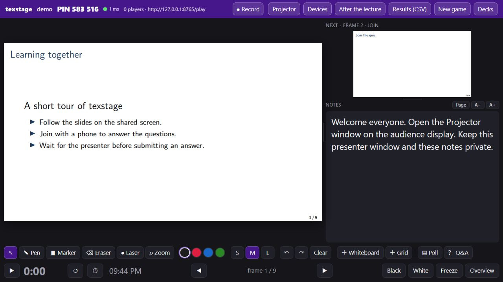

The private presenter workspace.

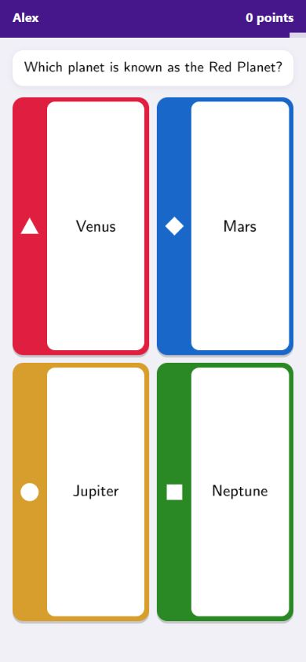

A participant answers in the browser.


## What texstage does

texstage turns a LaTeX Beamer presentation into an interactive teaching session. You write ordinary slides and add quiz commands in a .tex file. texstage compiles that source, prepares the presentation files, and runs a server that connects your presenter browser, the audience display and participants' phones. You can also create a static PDF handout or a PDF with solutions.

For example, a lecturer writes a multiple-choice question, presents its reading step, opens answering, and then reveals the explanation. Students open a join link, enter the session PIN and answer in a browser. The presenter sees the accepted answers and controls what the audience sees.

| Component | Your part in the session |
| --- | --- |
| Author | Edit a Beamer .tex file in a text or LaTeX editor. A quiz uses commands from texquiz.sty. |
| Presenter computer | Runs the Python command and local server. Builds source using TeX. The private presenter shows notes, next steps and controls. |
| Audience display | A separate projector browser window shows the shared slide. Use an extended desktop to keep notes and answers private. |
| Participant | Uses a reachable /play address, session PIN and nickname in a browser. No Python, TeX, app or account installation is needed. |

The browser workflow is the starting path in this manual. PowerPoint integration, recording, hosted servers and tunnels are optional later topics. texstage can present Beamer material without DBIS styling. It does not create the teaching content for you, and a static PDF by itself does not run a live quiz.


## Choose your starting path

| I want to... | Start here |
| --- | --- |
| Join a lecture | Go directly to Join and wait on your phone, or the Participant quick reference. Obtain the address and PIN from your presenter. Skip installation. |
| Author and present my own slides | Install Python, TeX and texstage below. Follow the supplied demonstration before editing your first quiz. |
| Present a supplied bundle | Install Python and texstage. TeX is only needed to rebuild source. Start texstage serve with a private data directory, open /stage, and use Upload a deck for the supplied .bundle.zip. |
| Organize a course as separate slide files | Use the separate lecture-tools project and its workflow manual. It assembles numbered slides and can call texstage for live output. |
| Use DBIS notation or appearance | Use lecture-tools' reusable LaTeX modules. DBIS branding is an optional theme, not a texstage prerequisite. |
| Edit a Jupyter notebook | Use the lecture-tools notebook manual. This path needs neither texstage nor TeX. |

| Term used here | Meaning |
| --- | --- |
| Deck / frame / overlay | A deck is a presentation. A Beamer frame is one logical slide; overlays reveal it in successive steps and can produce several PDF pages. |
| Build / bundle | Building converts source into output. A bundle packages slides, quiz data and browser assets for the server; .bundle.zip is its portable upload. |
| Server / port | The running program that coordinates the browsers; the port is its numbered network endpoint, such as 8765. Keep its terminal open during the session. |
| PIN / presenter key | The PIN admits participants to the current session. A presenter key authorizes control of the server. Give participants the PIN, not the key. |
| texstage / texquiz | texstage is the installed command and application. texquiz.sty is the LaTeX quiz package it ships. Some output folders retain the older name texquiz-out. |


## Install Python and obtain the source

Use CPython 3.12, 3.13 or 3.14 for this candidate; these are the versions targeted by its checks. Install Python from [python.org](https://www.python.org/downloads/) or your operating system package manager. Open a new terminal after installation. On Windows use PowerShell; on macOS or Linux use Terminal. Commands below are entered in that terminal, not in a Python prompt or a LaTeX editor.

A source checkout is an unpacked copy of the project. Obtain the matching candidate source archive or checkout from the maintainer. On a published GitHub repository, Code > Download ZIP provides source; unpack it first. This edition does not assume a public repository URL or a PyPI release. Do not substitute a similarly named package from a search result. Open the terminal in the extracted project folder containing pyproject.toml, requirements, examples and docs. Use cd followed by the quoted folder path to change folders; pwd shows where you are.

A virtual environment is a private directory of Python tools and dependencies for this installation. It avoids changing another course environment. Use a new .venv directory and keep your documents outside it. Choose the block for your operating system. Activation selects this environment for the current terminal window. See the [Python environment documentation](https://docs.python.org/3/library/venv.html).

### Windows PowerShell

```
python --version
python -m venv .venv
.\.venv\Scripts\Activate.ps1
```

If python selects another version or is unavailable, but the Python launcher is installed, use py -3.14 instead of python for these first two commands. If activation is blocked by PowerShell policy, use the following session-only alternative; it puts the environment executables first in this terminal without changing system policy.

```
$env:Path = (Resolve-Path .venv\Scripts).Path + ';' + $env:Path
```

### macOS or Linux

```
python3 --version
python3 -m venv .venv
. .venv/bin/activate
```

If your distribution reports that venv or ensurepip is missing, install its Python venv package for the selected Python version, then create the environment again. If python3 selects a different version, use an installed python3.14 (or python3.12/python3.13) for the version check and venv creation. After activation the remaining commands use python on every platform.

### Check the selected environment

```
python -c "import sys; print(sys.executable)"
python -m pip --version
```

The paths printed by both commands must point inside this project's .venv. Reopen and activate the same environment in each new terminal before running the tools. Installation downloads dependencies and needs network access; subsequent local examples use the files already installed.


## Install texstage and check the tools

Run these commands at the texstage source root in the environment just created.

```
python -m pip install --require-hashes --only-binary=:all: -r requirements/runtime.txt
python -m pip install --require-hashes --only-binary=:all: -r requirements/build.txt
python -m pip install --no-deps --no-build-isolation .
```

The first two commands install the tested dependency versions and packaging tools. The third installs this source copy. Keep the requirements files from the same candidate. If a hash check or binary download fails, check the Python version, platform and download source instead of removing the checks.

```
texstage --help
python -m pip check
python -c "from importlib.metadata import version; print(version('texstage'))"
```

Success means the command list appears, pip reports no broken requirements, and the version is 0.2.1.dev3 for this edition. If texstage is not found, check the environment paths above; on Windows its executable is .venv/Scripts/texstage.exe. There is no python -m texstage entry point.

LaTeX source is text; a TeX distribution turns it into a PDF. Beamer is the LaTeX document class for slides. Install a current full [TeX Live](https://tug.org/texlive/) distribution, [MacTeX](https://tug.org/mactex/) on macOS, or [MiKTeX](https://miktex.org/howto/install-miktex) on Windows. With MiKTeX, install missing packages and updates through MiKTeX Console before an unattended build. A LaTeX editor alone does not supply the compiler.

For texstage, install Beamer and its dependencies, TikZ and the optional qrcode package for QR rendering. The command supplies texstage's own .sty files automatically; do not install them into your global TeX tree for this tutorial.

```
pdflatex --version
```

Run these checks in the same terminal you will use for the tutorial. They must print version information. If a command is not found, finish the TeX installation, reopen the terminal and activate .venv again. Install any missing .sty dependency through your TeX package manager; pip installs Python dependencies, not TeX packages.

If you only serve a supplied bundle, skip the TeX installation. The source archive includes tutorials and dependency locks; a Python wheel is an installation package and is not a substitute for this tutorial source tree. See [installation.md](installation.md) for verified-wheel installation and optional PowerPoint setup.


## Start your first session

Goal: see a compiled slide, open the presenter, submit a practice answer, and reveal its result. Stay in the texstage source root with .venv active. Use the supplied synthetic example so this rehearsal does not touch any existing course.

### 1  Compile a static preview

```
texstage pdf --present examples/manual/demo.tex
```

The terminal prints the generated PDF path inside examples/manual/texquiz-out. Open that file in a PDF viewer. You should see the manual demonstration, including a join slide and question steps. This checks the TeX installation; opening the PDF does not start an interactive session.

### 2  Start the presenter and server

```
texstage present examples/manual/demo.tex --data .manual-data --port 8765 --no-tunnel
```

This builds the interactive outputs when needed, stores rehearsal session data in .manual-data, and opens the presenter at http://localhost:8765/stage. The first build takes longer than reopening an unchanged deck. Keep the terminal running. If the browser does not open automatically, open that address yourself. If you see the deck library, choose Present on the manual demonstration.

Use an unused port. If texstage is already serving on 8765, present reuses it, even if you supplied another data directory. Choose another unused port to keep rehearsals separate. --no-tunnel disables remembered tunnel settings for the selected data directory; here that directory belongs only to the rehearsal.

### 3  Rehearse as presenter and participant

- Choose Projector and allow its pop-up. With one monitor, keep it beside the presenter; with two, move it to the audience display.
- Advance to the join slide. For a laptop-only rehearsal, open http://localhost:8765/play in another browser tab, enter the current PIN and a practice nickname. Confirm that the player count increases.
- Advance to a question's reading step, then advance again to open answering. The demonstration allows 240 seconds. Submit an answer in the participant tab and check that the presenter counts it.
- Wait for the round to close or use Stop the question, then advance to reveal the answer. Compare the participant feedback with the audience display. The following illustrated sections explain these controls in detail.

### 4  Stop and resume

Finish the practice session and save any exports you need. Press Ctrl+C in the terminal that started the server to stop it. Closing a browser tab alone does not stop the server. Run the same present command from the same source root to reopen the deck and reuse the rehearsal data. Navigation backwards does not reset answered questions; use Ask again or New game as described later.


## Move from one laptop to a real phone

First confirm the laptop-only rehearsal works. Then put the presenter computer and phone on a network that allows them to reach each other. The server prints a line beginning phones join at. Open that /play address on the phone and enter the current PIN. The phone does not need access to the .tex file or the Python installation.

localhost and 127.0.0.1 mean the device you are using. They work for a participant tab on the presenter computer, but point to the phone itself when opened on a phone. The screenshot addresses are demonstration values; never copy them as the actual classroom address.

Check the printed address ending in /api/status from the phone if joining fails. If that page cannot be reached, check the computer's firewall and whether Wi-Fi client isolation blocks device-to-device connections. If several network addresses are printed, select the one reachable from the phone. A VPN or campus Wi-Fi may require a different network or a hosted setup.

```
texstage present examples/manual/demo.tex --data .manual-data --port 8765 --no-tunnel --public-url http://192.168.1.23:8765
```

The address above is only an example: replace 192.168.1.23 with your presenter computer's reachable address. Stop your rehearsal server before restarting with changed settings. --public-url changes the address advertised to participants; it does not configure the network or open a firewall. For access beyond the local network, follow the hosting and security guides linked in [installation.md](installation.md).


## Make the demonstration your own

After the first successful session, create a new folder named my-first-deck alongside the examples directory. Save the complete small quiz in Author a small quiz and choose the right export below as my-first-deck/deck.tex. Use a plain-text or LaTeX editor and save UTF-8 text with the .tex extension. Change the question title, choices and explanation; keep each quiz id unique within the deck.

```
texstage pdf --solutions my-first-deck/deck.tex
texstage present my-first-deck/deck.tex --data .manual-data --port 8765 --no-tunnel
```

Check the printed solutions PDF before presenting. Re-run present after saving an edit; it rebuilds changed source. If the presentation is already open, reload or reopen the deck after the build. For a clean practice round choose New game. A .tex edit alone does not alter the page already displayed in a browser.

| File or folder | Keep or share? |
| --- | --- |
| deck.tex and its images | Editable source: keep these under version control. |
| texquiz-out | Generated output beside the source. Rebuild it from source; do not edit its generated slide or quiz data. |
| Handout / solutions PDF | Choose the intended audience explicitly. Solutions disclose the answers. The default pdf command creates the handout. |
| .bundle.zip | Upload to the intended server to present elsewhere. It includes quiz definitions and answers; it is not a student handout. |
| .manual-data | Private rehearsal server state, including authorization material. Keep it out of public repositories and student downloads. |


## Choose a deck

### Open the library

The presenter is at `/stage` on your quiz server. On the server laptop it normally obtains the local presenter key automatically. A remote presenter uses an authorized key or a paired device.

- Choose **Present** on the deck you want to use.
- Use search to find a deck across folders. Choose **By name** or **Newest first** to change the order.
- Use **New folder** and the deck actions menu to organize your library.
- Use **Upload a deck** for a `.bundle.zip` created by texstage build. Upload the bundle, not an arbitrary PDF.

A deck built while the library is open appears after a reload. A browser presentation requires a build containing the stage PDF; rebuild without `--no-stage` if it is missing.

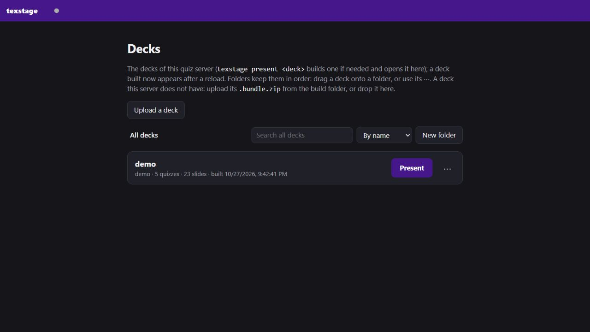

Deck library. Present opens the private presenter workspace; the three-dot menu contains deck actions.


## Know your presenter workspace

- **Current slide, left:** the step being presented, including live quiz content.
- **Next, upper right:** a preview of the next step. It may show the correct answer before the audience sees it.
- **Notes, lower right:** switch between rendered **Page** and **Text** views. Use **A- / A+** for text size.
- **Top bar:** session PIN, connection indicator, latency, player count and join address. Projector, exports and session controls are here.
- **Bottom bar:** annotation tools, slide navigation, elapsed timer, display controls and Overview.

Show the **Projector** window to the audience. Keep this presenter window private: its notes, previews and controls are for you. Drag the dividers to adjust the slide and notes areas; double-click a divider to restore its default position.


Presenter workspace with text notes. Next previews the join slide. The elapsed lecture timer is separate from a quiz countdown.


## Connect the audience

- Choose **Projector**, move that window onto the audience display, and use an extended desktop. If a pop-up is blocked, allow the projector window for this server. The projector can enter full screen when clicked; F is the presenter freeze shortcut, not its full-screen command.
- Advance to the join slide. Participants scan its QR code or open its address, enter the current PIN and choose a nickname.
- Test the join address on a real phone before the session. The screenshots use 127.0.0.1 for a local demonstration; on a phone that address points to the phone itself. Use the reachable address printed by your actual server.

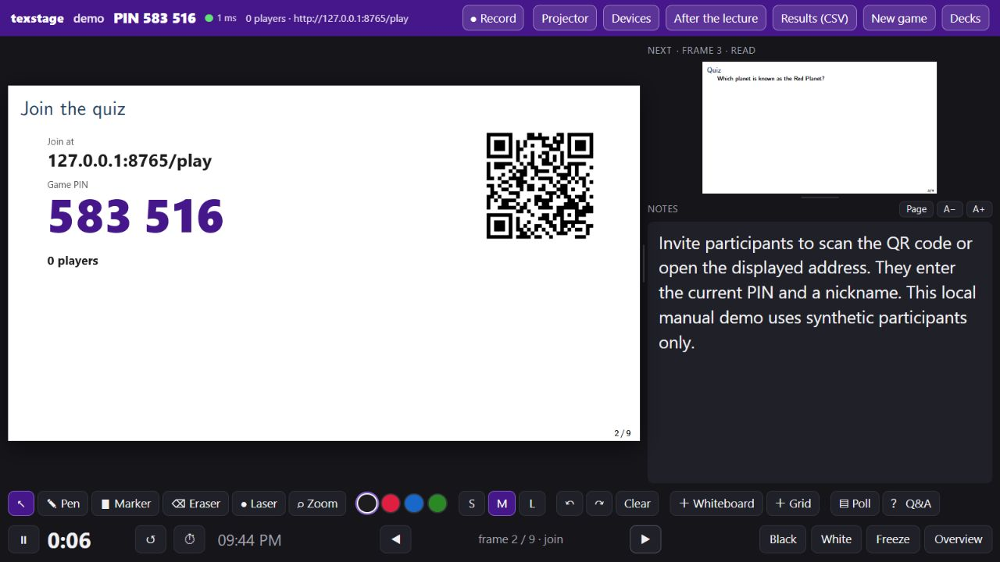

The join slide shows the session address, PIN, QR code and player count. The PIN shown here is only an example.


## Join and wait on your phone

No app installation is needed. Open the session address in a browser, enter the PIN shown in the room and a nickname, then tap **Join**. A QR code may prefill the PIN. **You're in!** confirms that joining succeeded.

When the question appears, read it first. The reading screen deliberately has no answer buttons. Wait for the presenter to advance again. Keep this browser tab open throughout the session.

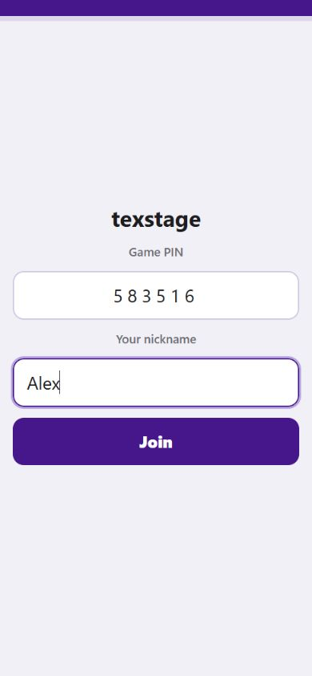

Enter the current PIN and a nickname.

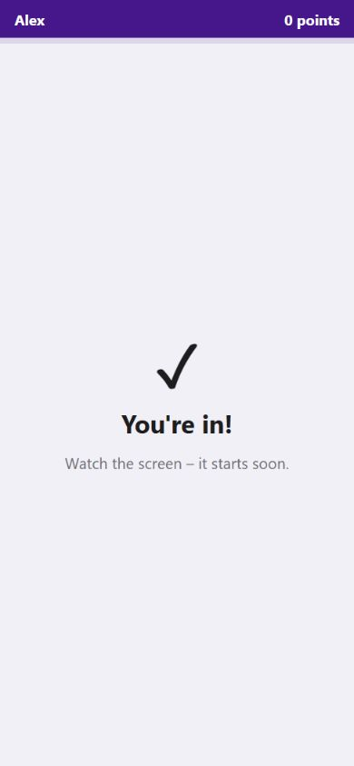

Wait for the presenter after joining.

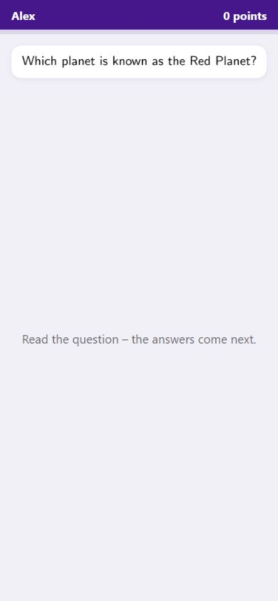

Read first; the answers open on the next step.


## Run a timed question

- **Read:** advance onto the reading step. The question appears on the shared screen and phones, without starting the round.
- **Open:** advance once more. A three-second Get ready countdown precedes the answer timer.
- **Control:** move the pointer over the live quiz to find **Pause**, **+10 s** and **Stop the question**. Pausing the quiz also pauses the answering interface on phones.
- **Close:** the round can close when the time runs out, when all connected participants have answered, or when you stop it.
- **Reveal:** advance to the reveal step or use **Show the answer** when offered. Discuss the explanation and results.

The answer counter is accepted answers / (accepted answers + connected players still waiting). A submitted answer remains counted if its phone disconnects. Unanswered offline participants drop out of the denominator until they reconnect.

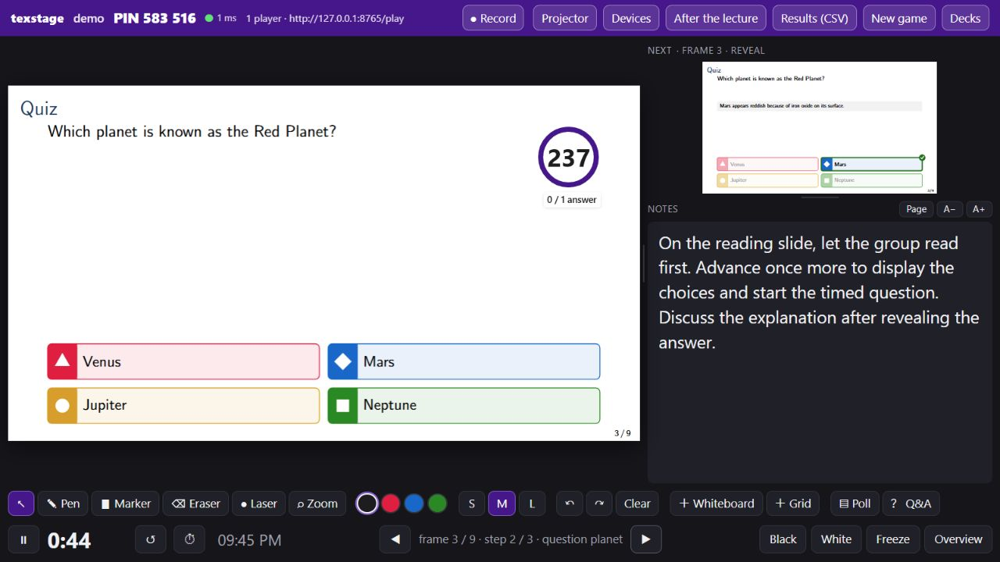

A question is open, with its countdown and answer counter. The private Next pane already previews the reveal.


## Submit an answer and read feedback

For a single-choice or true/false question, tap one answer to submit it immediately. For multiple selections and other input forms, use **Submit**. **Answer sent** confirms acceptance; wait for the reveal rather than tapping again.

After reveal, the phone shows the result, points and rank when scoring is enabled. Polls and practice rounds have different feedback. The score here is illustrative: timing, question settings and streaks can affect points.


Tap one answer in a single-choice round.

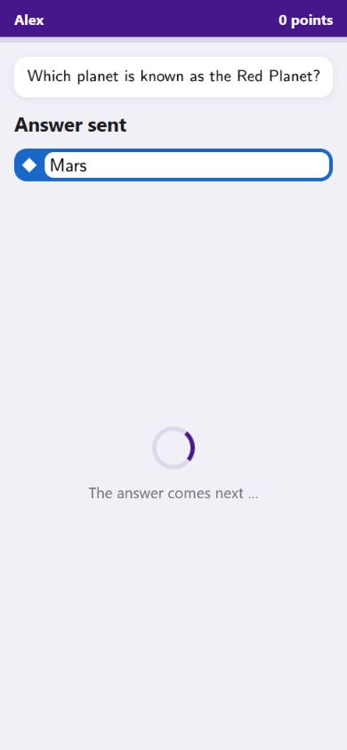

The submitted answer is acknowledged.

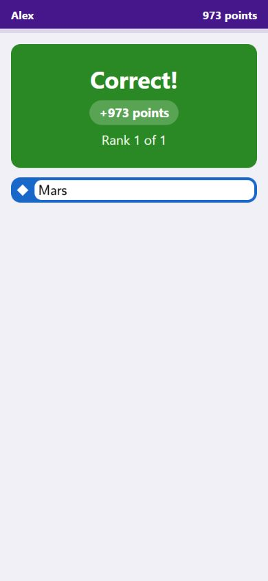

Feedback appears after the presenter reveals it.


## Reveal and discuss the result

- The reveal can show the correct choices, response counts and an explanation authored in the deck. Give the group time to discuss why an answer is correct.
- Going backwards does not automatically restart a question. Its previous state and results are retained.
- **Ask again (practice)** reruns the question without points and rewinds later questions so they can run anew. Use it deliberately: it also discards the affected later answers and points. Use **New game** for a fresh group and a new PIN.

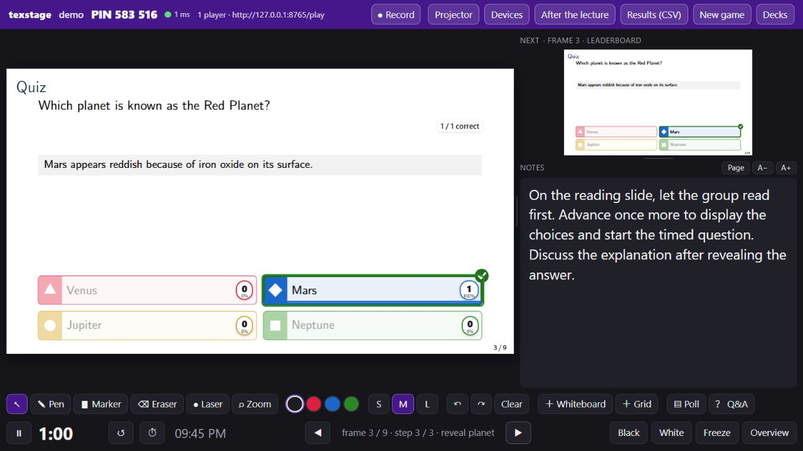

Reveal view for the planet question. The correct answer is marked and the authored explanation is visible.


## Use the different answer formats

For **multiple choice**, tap every intended answer and then **Submit**; selected answers have check marks. For **numeric** questions, set the slider or enter a number, check its units and submit. For **ordering**, use the up/down buttons to arrange the items before submitting.

Text and open-response questions provide a text field. Sketch questions provide a drawing pad with pen colors, Undo, Clear and Submit. A poll can use one or several choices and has no correct answer. Follow the instructions shown on that round.

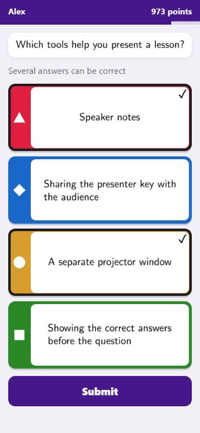

Multiple selections need an explicit Submit.

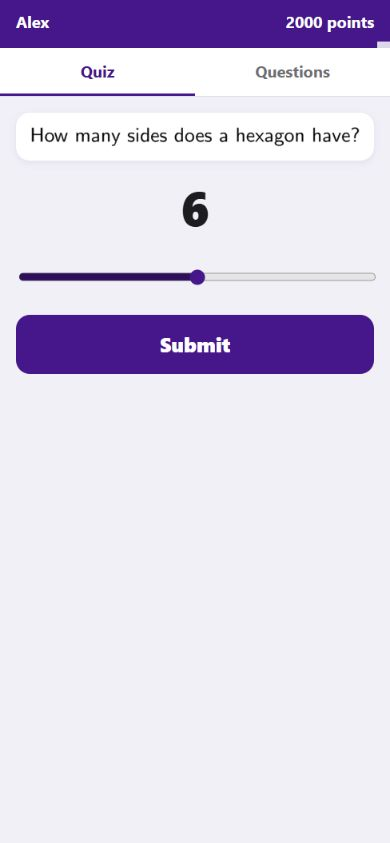

Numeric input can be a bounded slider.

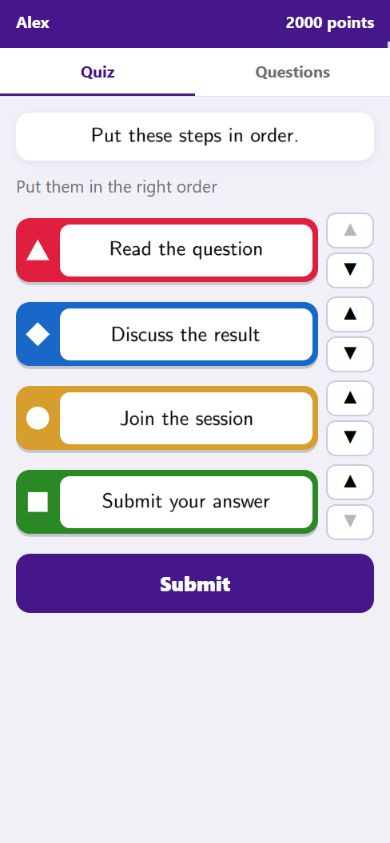

Reorder the items using the up/down buttons.


## Navigate and control the shared display

### Move through the deck

Use **Next / Previous**, the arrow keys, PageDown / PageUp, or a clicker. Space and Enter also advance. A frame can contain several steps: reading, answering and reveal are different steps of the same quiz frame.

Choose **Overview** or press **G** to jump to a frame. Type a frame number and press Enter to jump directly. Home and End go to the first and last steps. Esc closes the overview or leaves a selected tool.

### Control what the room sees

- **Black (B)** or **White (W)** temporarily covers the projector output.
- **Freeze (F)** holds the projector while you navigate privately. Select it again to resume live display.
- **T** controls the elapsed lecture timer. It does not pause a live quiz round.

Keep the overview private: its thumbnails may include reveal answers. Test your clicker and projector window before participants arrive.

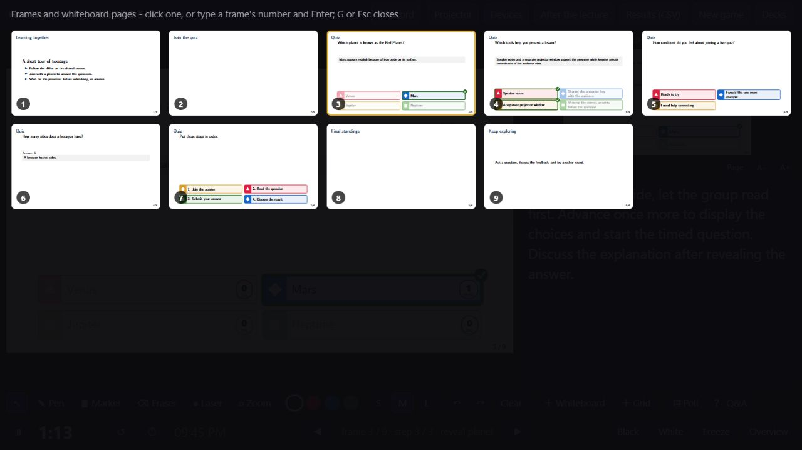

Overview displays one thumbnail per frame and lets the presenter jump directly. Correct answers can be visible in these thumbnails.


## Ask and moderate audience questions

In the presenter, open **Q&A** and enable **open for the phones**. Participants then get a **Questions** tab where they can submit a question and upvote another open question. Their own question cannot be upvoted by them.

Use **Show** to place a question on the projector, **Hide** to remove it from the screen, and **Done** when it has been addressed. Delete and Block are moderation actions. Closing the panel alone does not close submissions; turn off **open for the phones** when finished. Questions are displayed without the participant nickname.

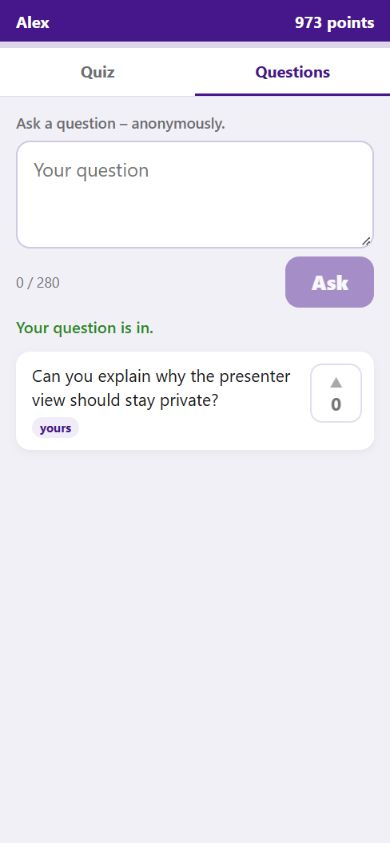

A participant submits a question from the Questions tab.

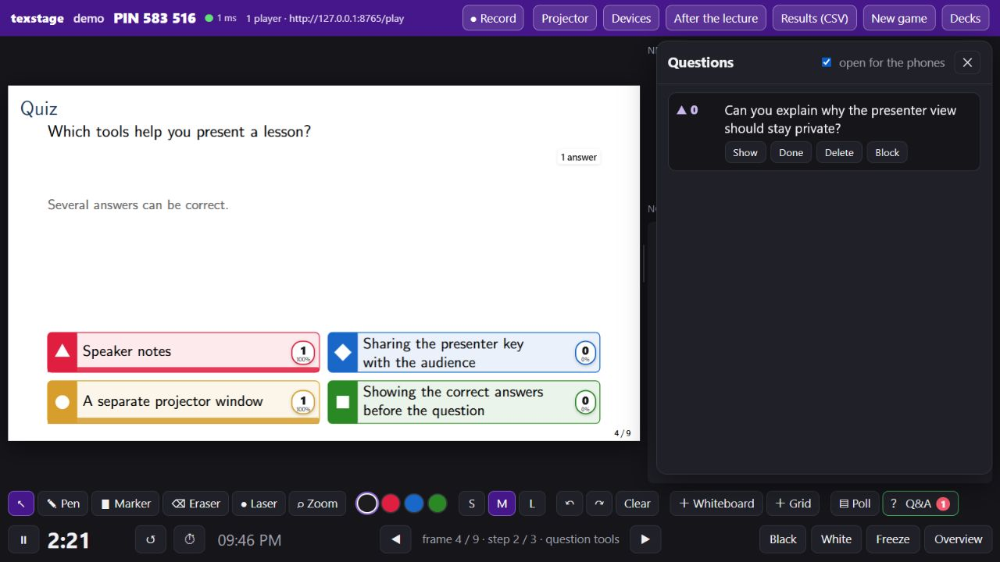

The presenter chooses which question to show and when to mark it done.


## Use annotation and optional presenter tools

| Tool | How to use it |
| --- | --- |
| Pen / Marker / Eraser | Select a tool, choose a color and width, then draw on the current slide. Undo and Redo change ink; Clear removes the current frame's ink. A compatible pen can draw while navigation mode is selected. |
| Laser / Zoom | Use Laser to point. With Zoom selected, drag a box over the slide; use Zoom or Z again to return to the full slide. |
| Whiteboard / Grid | Insert a whiteboard page after the current frame. Write or draw on it as you would on a slide. It can be included in the annotated PDF. |
| Poll | Ask an unplanned Yes / No, A-F, scale, word-cloud, text or sketch question. Set the question, choices and time, then choose Ask now. Return to the deck with the next-step command or Esc. |
| Devices | On the laptop choose Pair a device. Open or scan the offered link on the other device, then approve the request on the laptop. Only approve devices you intend to give presenter control. |
| Record | Choose the microphone and start recording; in the browser chooser select the projector window or display. Select the intended audience output, not the private presenter view. Stop recording before exporting it. |
| Sketches / Activities | These controls appear for matching content in the deck. Sketches lets you choose submitted drawings to display; Activities provides controls for authored live activities. |

Recording and device/screen integration depend on browser support and permissions. Microphone and screen recording were not part of the screenshot session. Rehearse them on the presenting computer before class. The [authoring guide](authoring.md) and [installation guide](installation.md) cover the wider workflows.


## Finish the session and export the material

A podium slide finishes the quiz session and shows final standings on phones. **After the lecture** opens the export tools; opening that panel alone does not end a quiz. **New game**, or returning to the join slide after a podium, starts a new session with a new PIN.

Choose **Make the PDF** for the last-shown version of each frame, ink and whiteboard pages; the PDF is also saved to the server archive. **Results (CSV)** exports participant results. The archive ZIP combines the annotated PDF, if generated, and results. Recorded takes appear in the Recordings list. Review student-facing files before sharing; keep result data and presenter credentials private.

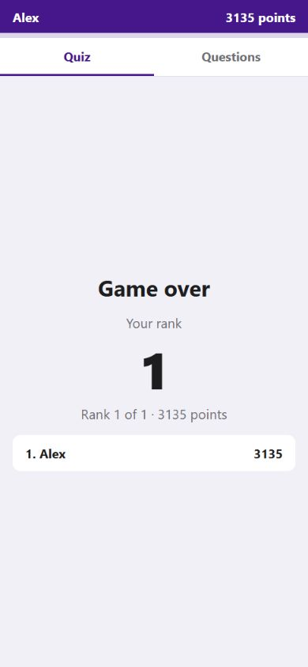

The phone displays the final rank at the end.

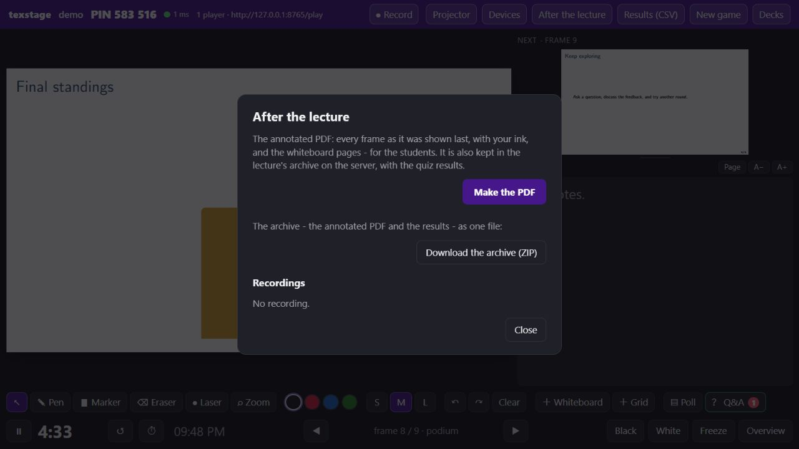

Generate the annotated PDF and download the archive. No recording was made in this example.


## Author a small quiz and choose the right export

A quiz belongs in a Beamer document. Give each question a stable, unique ID. Mark correct choices with `\choice*`; ordinary `\choice` entries are distractors. `\explain` supplies feedback. The existing authoring guide describes all question types and options.

```
\documentclass{beamer}
\usepackage{texquiz}
\begin{document}
\quizjoinframe
\begin{quiz}[id=planet, time=20]{Which planet is known as the Red Planet?}
  \choice{Venus}
  \choice*{Mars}
  \explain{Mars appears reddish because of iron oxide on its surface.}
\end{quiz}
\quizpodiumframe
\end{document}
```

| Command or file | Use |
| --- | --- |
| texstage pdf deck.tex | Handout with quiz placeholders; the default PDF mode. |
| texstage pdf --solutions deck.tex | Questions with correct answers and explanations. |
| texstage pdf --present deck.tex | A static PDF preview of the live presentation steps. |
| texstage build deck.tex | Build the live PowerPoint file, static PowerPoint fallback and server bundle. |
| deck.bundle.zip | Upload this package to a texstage server. |
| deck.pptx / deck-static.pptx | The live deck needs the server/add-in and may carry its presenter key. The static fallback has no live quiz. |

Output normally goes to `texquiz-out` beside the source; use `--output-dir` to choose another location. For PowerPoint, install the add-in on the presenting PC, then use `texstage present deck.tex --powerpoint`. Rehearse with `texstage check deck.pptx` and start from its preparation slide. Keep the live PPTX out of student downloads.


## Troubleshoot before and during a session

| Symptom | What to do |
| --- | --- |
| A phone cannot open the join page | Use the actual reachable server address, not localhost or 127.0.0.1. Check the network and firewall. Open /api/status at that same address from the phone. Campus networks may isolate devices; use a suitable hotspot or configured hosted server/tunnel. |
| The PIN is rejected | Read the current PIN from the presenter or join slide. New game creates a different PIN; an old screenshot or previous session PIN will not work. |
| The phone has no answer buttons | A lobby or reading screen is normal. Wait for the presenter to open the round. If it says Paused, the presenter must resume the quiz. |
| The phone says Reconnecting | Restore its network connection and keep the same browser/tab. A saved participant token lets the same player resume after a reload. A different browser or cleared storage can lose that identity. |
| The presenter needs a key | Use the correct server's authorized presenter key or pair the device from the laptop. Participants need only the PIN and nickname. |
| Projector does not open or move | Allow its pop-up for this server. Move the window manually if automatic placement is unavailable. Use extended displays so the presenter stays private. |
| The projector seems stuck | Check Freeze, Black and White. Return to normal display. Also check the presenter connection indicator. |
| A question will not restart | Going backwards preserves its state. Choose Ask again for practice or New game for a new session; review the rewind effects first. |
| A deck or stage PDF is missing | Reload the library after building, upload the .bundle.zip to the intended server, or rebuild without --no-stage. Check the first LaTeX error if the build failed. |
| Recording has no sound | Check browser permission, the selected microphone and its level meter. Make a short rehearsal recording and play it back. |

Before class: verify the build, join from a real phone, rehearse one question and its reveal, check the projector and notes, and know which static PDF/PPTX you will use if the live connection fails.


## Participant quick reference

### Join

- Scan the QR code or open the address shown in the room.
- Enter the current PIN and a nickname. Tap Join and wait for You're in!.
- Keep the same browser tab open so a reconnection can restore your place.

### Answer

- Read the question first. The presenter decides when answers open.
- Single choice or true/false: tap one answer; it submits immediately.
- Multiple choice: select all intended answers, then tap Submit.
- Number, text, ordering or sketch: complete the input, then tap Submit.
- Wait for Answer sent and then the reveal. Your result and score appear when the round allows it.

### Ask for help

- If Questions is available, submit a question there or upvote another question.
- If you cannot connect, tell the presenter. Check the current PIN and that your network can reach the displayed address.
- Do not enter a presenter key. The participant page needs only the session PIN and nickname.


## Presenter shortcut card

| Action | Shortcut | Action | Shortcut |
| --- | --- | --- | --- |
| Next / previous | Right / Left, PageDown / PageUp | Overview | G |
| Jump to frame | Number, then Enter | Black / White | B / W |
| Freeze / unfreeze | F | Elapsed timer | T |
| Pen / Marker / Eraser | P / H / E | Laser / Zoom | L / Z |
| Whiteboard / Grid | N / Shift+N | Undo / Redo | Ctrl+Z / Ctrl+Y |

This shortcut card is for the texstage browser presenter. PowerPoint uses its own presentation controls. The lecture timer shortcut does not pause a quiz countdown.


## About the screenshots and further help

The screenshots show texstage 0.2.1.dev3 from the release-preparation source revision `daf0976b67954613a839b111f9696e41ab000433`, captured on 27 October 2026. The desktop viewport was 1280 x 720; phone screens used a 390 x 844 browser viewport. Browser size is emulated; physical phone hardware was not tested for these captures.

All content, nicknames and results are synthetic. Alex is an example participant. The PIN, local address and scores are illustrations, not credentials for a running class. The demonstration server was isolated from existing courses and presenter data. Phone controls shown here are in English; the participant interface can use German according to browser language.

The source deck is [examples/manual/demo.tex](../examples/manual/demo.tex). It uses 240-second quiz rounds for capture and rehearsal. Replace the example local join address and choose a realistic round duration for teaching. Live session join information comes from the server's advertised address.

| Companion guide | Contents |
| --- | --- |
| installation.md | Source/wheel installation, TeX requirements, hosting overview and common setup failures. |
| authoring.md | Full quiz syntax, question options, presentation workflows and hosting details. |
| integration.md | Supported Python integration API for companion course tools. |
| dependencies.md | Locked environments and dependency updates. |
| SECURITY.md | Private reporting and handling of keys, inputs and server data. |
| releasing.md | Publication prerequisites and candidate validation. |

For a reproducible problem, record the package version, operating system, browser, TeX version and exact command, and reduce it to a synthetic example. Remove presenter keys and participant data from logs or screenshots before sharing them.

Screenshot sources and hashes are listed in [images/manual/captures.json](images/manual/captures.json). The [manual maintenance guide](manual-maintenance.md) explains how to refresh the images and regenerate all reading formats.


## LaTeX reference: packages and loading

Use this section as a lookup after completing the first-session tutorial in the [user manual](manual.md). Install and verify texstage with the [installation guide](installation.md); the CLI makes the packaged styles available to TeX. Authors usually begin with texquiz.sty and the complete small-quiz example earlier in the manual. Load texvideo or texactivity only when the deck uses those features.

This reference covers all four shipped LaTeX packages and their author-facing commands, environments, keys and theme hooks. Beamer, TikZ and other upstream commands retain their own upstream contracts. Core developer interfaces are identified separately. Examples target the current 0.2.1.dev3 candidate.

| Syntax / option | Meaning and default |
| --- | --- |
| `texstage.sty` | Shared mode selection, page records, geometry and phone assets. Loaded automatically by every content package; it does not select a course theme. |
| `texquiz.sty` | Quizzes, quiz/answer frame options, join/leaderboard/podium frames and customizable answer rendering. Requires the core, TikZ and pdftexcmds; QR support is optional. |
| `texvideo.sty` | The video command, static posters and live playback metadata. Requires the core, graphicx and TikZ; qrcode is optional. |
| `texactivity.sty` | Tuple and code activities, prompts, seeds and reference answers. Requires the core and Beamer facilities. |
| `docs/manual-latex/manual.sty` | Documentation layout only: headings, typography, tables and page furniture. Do not load it in a lecture deck. |

```
\documentclass[aspectratio=169]{beamer}
\usepackage{texquiz}
\usepackage{texvideo}     % only needed for video
\usepackage{texactivity}  % only needed for activities
\begin{document}
% Frames and quiz environments go here.
\end{document}
```

The texstage CLI supplies the installed style directory. For plain pdfLaTeX, put the four generic files on the TeX search path or use the repository-relative loading shown in the reference example. Do not mix package copies from different revisions. DBIS themes and course notation belong to lecture-tools.


## Build modes and notes

| Syntax / option | Meaning and default |
| --- | --- |
| `\def\texstagemode{handout}` | Define before documentclass. Quiz and answer frames become neutral placeholders; videos remain posters and activities retain their prompts. |
| `\def\texstagemode{solutions}` | Questions, correct choices and explanations are visible. Activity references are printed. Videos remain posters. |
| `\def\texstagemode{present}` | Live layout and .tqz metadata. The builder makes the browser bundle and PowerPoint exports; compiling a raw PDF does not start a live session. |
| `\def\texquizmode{...}` | Legacy alias accepted when texstagemode is absent. An explicitly defined texstagemode takes precedence. |
| `No explicit mode` | At begin-document, Beamer notes enabled selects solutions; otherwise handout. Use explicit modes when this distinction matters. |
| `\texquiznotes` | Build-owned switch: empty selects extraction-oriented notes on the right; stage selects separate note pages, omits extra phone-asset pages and stabilizes the stage PDF. Let the CLI set it. |

```
texstage pdf examples/reference/reference.tex
texstage pdf --solutions examples/reference/reference.tex
texstage pdf --present examples/reference/reference.tex
texstage build examples/reference/reference.tex
```

The core needs a LaTeX kernel dated 2023-06-01 or newer. Present mode supports pdfLaTeX and has a LuaLaTeX code path; the supplied examples are validated with pdfLaTeX. XeLaTeX is rejected for present mode. Live video codecs, external display placement and Office playback need separate platform rehearsal.


## Quiz environments and body commands

| Syntax / option | Meaning and default |
| --- | --- |
| `\begin{quiz}[keys]{question} ... \end{quiz}` | Between frames, creates its own frame. Inside a frame, that frame must have the quiz option. The question is required; one quiz per frame, no authored overlays in quiz frames. |
| `\quizsetup{keys}` | Sets deck-wide defaults and display strings. Call after loading texquiz and after any theme whose defaults you want to override. |
| `\choice[id=label]{text}` | Adds an incorrect choice. Nonempty text; id defaults to A, B, ... in authored order. Explicit ids use 1-32 ASCII letters/digits/hyphens and must be unique within the quiz. |
| `\choice*[id=label]{text}` | Marks a correct choice. Several starred choices infer multiple choice; explicit type=multiple also permits one starred choice. |
| `\explain{text}` | At most one explanation per quiz. Shown on the built-in reveal/solutions page; with reveal=none, explain on a separate answer frame. |
| `\accept{text}` | One or more accepted answers for type=text. Hyperref converts the authored text to plain Unicode for scoring. Use texorpdfstring for unsupported math/macros. |
| `\step{text}` | One nonempty ordering item, written in the correct order. The displayed order is shuffled. |
| `\note{text}, \label{name}` | Beamer commands accepted in a quiz body; notes and stable slide references remain available. The quiz title is not its id. |

Choice, explanation, acceptance and step commands are local to the quiz body. Do not put arbitrary paragraphs, verbatim or listings directly in that body. Put supporting material in a surrounding fragile,quiz frame and keep the question/reveal layout compact. Explicit choice ids identify authored choices; the public A/B/... labels follow the displayed order after shuffling.


## Quiz types and scoring

| Syntax / option | Meaning and default |
| --- | --- |
| `single` | 2-6 choices, exactly one correct. Inferred when one choice is starred. |
| `multiple` | 2-6 choices, at least one correct. Exact-set scoring by default; partial=true enables partial credit. |
| `truefalse` | answer=true or answer=false; no choice commands. Labels come from true-label and false-label. |
| `poll` | 2-6 unstarred choices. Explicit type=poll; select=single by default or multiple. No correct answer and no points. |
| `numeric` | Decimal answer and optional tolerance; no answer means an unscored estimate. Bounds may produce a slider. |
| `text` | At least one accept command. Scoring normalizes case, accents and whitespace; author meaningful accepted variants rather than relying on literal TeX source. |
| `open` | Unscored free text. display=wordcloud by default, or list; max-chars defaults to 80. |
| `order` | 2-6 step commands in correct order. Exact ordering by default; partial=true credits correctly placed items. |
| `sketch` | Unscored drawing input. No choices, accepted answers, steps or answer key; presenter chooses drawings for display. |

Type inference checks ordering items, accepted text, choices, then a boolean/numeric answer. Polls, open text, sketches and numeric estimates without an answer should declare their type. Poll/open/sketch/estimate questions force points=none; explicitly requesting scoring for them is an error. Scoring is server behavior, not a LaTeX calculation.


## Quiz options: identity, timing and layout

| Syntax / option | Meaning and default |
| --- | --- |
| `id` | Required, unique across the deck: 1-63 characters, starts with a lower-case letter or digit, then lower-case letters/digits/hyphens. |
| `type` | single, multiple, truefalse, poll, numeric, text, open, order or sketch; otherwise inferred when unambiguous. |
| `time` | Integer 5-240 seconds. Inherits quizsetup; initial default 20. |
| `points` | standard, double or none. Inherits quizsetup; initial default standard, except forced-unscored types. |
| `leaderboard` | true/false; bare key means true. Default follows setup and is false for unscored questions unless explicitly set. Automatic result pages do not increment the authored frame number. |
| `shuffle` | true/false; bare key means true. Initially false. Deterministic choice shuffling is shared between slide and phones; ordering questions are always shuffled. |
| `reveal` | slide (default) creates the built-in reveal; none defers it to an answer frame. |
| `title` | Title of a generated quiz frame; initially Quiz. Inside an authored frame, use that frame title. A neutral title is used for handout placeholders. |
| `cols` | 1-6 forces the choice columns. Unset uses measured fitting and the theme maximum (2 in the generic theme). |
| `partial` | Boolean, false by default; bare key means true. Meaningful for multiple choice and ordering; it changes credit, not which answer is fully correct. |

Time, points, leaderboard, shuffle, reveal and title have setup-level counterparts. Per-question values override them. Other question keys listed in the following section are not accepted by quizsetup.


## Quiz options: answer data

| Syntax / option | Meaning and default |
| --- | --- |
| `select` | Only polls: single (default) or multiple. |
| `answer` | true/false for truefalse; a decimal for numeric. Omit for an unscored numeric estimate. |
| `tolerance` | Numeric tolerance, default 0. Must be nonnegative. |
| `min, max` | Optional numeric bounds. min must not exceed max; a scored answer interval must intersect the allowed range. Both bounds select a phone slider. |
| `step` | Positive numeric slider increment, default 1 when a slider is used. At least one value min + k*step must fall in the correct interval. |
| `unit` | Optional numeric unit text, initially empty, e.g. ms. |
| `display` | Only open text: wordcloud (default) or list. |
| `max-chars` | Open-text input limit, default 80; the build validates 1-200. The TeX parser accepts digits before the bundle validation applies the range. |

```
\begin{quiz}[id=latency, type=numeric, answer=2.5,
    tolerance=0.1, min=0, max=5, step=0.1, unit={ms}]{Latency?}
  \explain{The measured latency was 2.5 ms.}
\end{quiz}
\begin{quiz}[id=term, type=text]{Name the language.}
  \accept{SPARQL}
  \accept{\texorpdfstring{\textsc{sparql}}{SPARQL}}
\end{quiz}
```

Use ordinary decimal notation such as -1.5, not exponents or a comma decimal separator. Avoid irrelevant keys: the supported contract is the type-specific one above, even where a parser accepts an unused value.


## Setup defaults and session frames

| Syntax / option | Meaning and default |
| --- | --- |
| `\quizsetup{time=20, points=standard}` | Initial time and scoring defaults; same valid values as quiz options. |
| `leaderboard=true, shuffle=false, reveal=slide` | Initial global behavior. A DBIS theme changes some of these defaults. |
| `title=Quiz, join-url={}` | Default quiz title; no static join address until you supply one. The live server supplies the active address/PIN. |
| `\quizjoinframe[title=..., note={...}]` | Creates a join frame outside any frame. Default title Join the quiz. Static modes show join-text and join-url; live mode displays the active session. |
| `\quizleaderboardframe[title=..., note={...}]` | Explicit standings frame outside any frame. Default title Leaderboard. This is separate from automatically inserted post-question standings. |
| `\quizpodiumframe[title=..., note={...}]` | Final standings outside any frame. Default title Final standings; reaching it finishes the live quiz session. |
| `title, note (frame keys)` | The only keys accepted by these three frame commands. note is optional, may contain paragraphs, and is carried to presenter notes. |
| `\begin{frame}[quiz]` | Hosts an inline quiz. The whole frame is replaced by a neutral placeholder in handout mode. Use fragile,quiz when the supporting material contains listings. |
| `\begin{frame}[answer=quiz-id]` | Reveals that quiz on this frame. With bare answer the frame is hidden in the handout, but has no quiz-id association. |

For delayed answers, give the quiz reveal=none, then write an answer=its-id frame later. Do not put quizjoinframe, quizleaderboardframe or quizpodiumframe inside a frame: each command creates one.


## Quiz display strings (1/2)

These quizsetup keys replace visible static slide text. Values below are the generic English defaults, before a course theme is loaded. They do not configure the language of the phone application.

| Setup key | Initial text |
| --- | --- |
| `join-title` | Join the quiz |
| `join-text` | During the lecture, join with your phone using the PIN shown on this slide. |
| `leaderboard-title` | Leaderboard |
| `podium-title` | Final standings |
| `handout-heading` | Live quiz |
| `handout-text` | This question is asked live in the lecture. |
| `results-text` | The results are shown live in the lecture. |
| `answer-title` | Answer |
| `answer-heading` | Answer |
| `answer-text` | The answer is shown in the lecture. |

```
\quizsetup{title=Question, true-label=Yes, false-label=No}
```

Use braces for values containing commas or paragraphs. Change the setup after loading a theme to retain your override. For the DBIS German strings and its leaderboard defaults, see the separate lecture-tools style reference.


## Quiz display strings (2/2)

These quizsetup keys replace visible static slide text. Values below are the generic English defaults, before a course theme is loaded. They do not configure the language of the phone application.

| Setup key | Initial text |
| --- | --- |
| `true-label` | True |
| `false-label` | False |
| `number-hint` | Enter a number on your phone. |
| `text-hint` | Type your answer on the phone. |
| `multiple-hint` | Several answers can be correct. |
| `poll-hint` | Tick all that apply. |
| `order-hint` | Put the items in the right order on your phone. |
| `sketch-hint` | Draw your answer on your phone. |
| `answer-label` | Answer: |
| `accepted-label` | Accepted answers: |

```
\quizsetup{title=Question, true-label=Yes, false-label=No}
```

Use braces for values containing commas or paragraphs. Change the setup after loading a theme to retain your override. For the DBIS German strings and its leaderboard defaults, see the separate lecture-tools style reference.


## Quiz theme hooks

| Syntax / option | Meaning and default |
| --- | --- |
| `\texquizprompt{text}` | Draws the question within its supplied width. Generic default: large text. |
| `\texquizchoice {label} {shape} {width} {height} {state} {content}` | Draw an answer with exactly the supplied geometry. height may be empty for natural height. Reference point must be the lower-left corner. |
| `\texquizchoicefont` | Answer font, generic default normalsize. Redefine with renewcommand. |
| `\texquizchoiceoverhead` | Width reserved besides answer text, generic default 2.31cm. Must match the actual box padding and live-count reserve. |
| `\texquizmaxcols` | Maximum automatically chosen columns, generic default 2. |
| `\texquizexplanation{text}` | Reveal/solutions explanation; default is a light panel. |
| `\texquizhint{text}` | Input hint; generic default small text in texquiz-hint color. |
| `\texquizbadge{n}` | Inline shape badge, n=1..6: triangle, diamond, circle, square, star, hexagon. |

The choice label is A, B, ... or an ordering rank. shape is 1-6; state is plain, correct or wrong. Correct and wrong choices must look identical in state plain. Keep geometry consistent because the server overlays counts and live content on the recorded rectangles.

Colors are texquiz-1 through texquiz-6, texquiz-correct, texquiz-panel and texquiz-hint. They style the PDF/deck rendering; a TeX color change alone does not restyle the phone UI. Private macros containing @ or __ are implementation details.

```
\renewcommand{\texquizprompt}[1]{{\Large\bfseries #1\par}}
```


## Video command and options

Load texvideo, then place the command inside a Beamer frame. Every video requires a local JPEG/PNG poster. Paths are relative to the deck directory. The poster determines the rendered aspect ratio; match it to the video.

| Syntax / option | Meaning and default |
| --- | --- |
| `\video[keys]{source}` | source is a local media file or online address. A local file must exist. The command can be used in overlays and repeated frames. |
| `poster` | Required image. The bundle builder accepts .jpg, .jpeg and .png. |
| `width, height` | Optional graphicx dimensions; with neither, the poster uses its natural dimensions. Supply one dimension to preserve aspect ratio. |
| `id` | Optional; derived from source basename/address when omitted, lower-cased and normalized. Use an explicit stable id for predictable reuse. |
| `start, end` | Optional times in seconds. Omitted means the player default beginning/end. Supply nonnegative values with end after start. Playback interpretation is player-specific. |
| `loop, muted, autoplay` | Booleans, initially false; a bare key means true. autoplay requests playback on entering the slide, subject to browser policies. |
| `url` | Optional online copy for the handout link/QR. If omitted for an online video, its source URL is used; a local video otherwise shows its filename. |

```
\begin{frame}{A short demonstration}
  \video[id=demo-clip, poster=poster.jpg, width=.75\textwidth,
         start=5, end=20, muted]{clip.mp4}
\end{frame}
```

Reusing an id retains the same video and playback state. Its source, poster and playback keys must agree. Repeating the same id twice on one slide is an error. Give separate videos distinct ids.


## Video output and portability

| Syntax / option | Meaning and default |
| --- | --- |
| `Handout / solutions` | Poster plus a play mark and filename or link. A QR code is added for an online link when qrcode.sty is available. The PDF does not embed a playing video. |
| `Browser presentation` | Local media is copied into the bundle. YouTube, Vimeo and supported direct media URLs get live players; an unsupported online URL produces a warning and keeps its poster. |
| `PowerPoint, live and static` | Local media becomes a native movie object. An online video becomes a linked poster. Browser-only playback options are not applied by the current native PowerPoint movie writer. |
| `Local formats` | The builder recognizes .mp4, .m4v, .webm and .mov. MP4 with H.264/AAC is the documented cross-workflow target; actual playback depends on installed/browser codecs. |
| `Network and size` | Online playback needs its provider/network. Local media is duplicated into the bundle and both PPTX files; videos over 100 MiB cause a build warning. |

Compilation checks poster geometry and packaging, not successful playback on every browser or Office version. Rehearse actual media on the presentation device. The documentation example uses a synthetic external URL so it builds without downloading media; it is explicitly a poster/link example, not a playable movie test.

The full command contract is in texvideo.sty and src/texstage/build/video.py. Do not interpret a warning-only online URL as proof that an embedded browser player exists for it.


## Activity environment and common options

| Syntax / option | Meaning and default |
| --- | --- |
| `\begin{activity}[keys] ... \end{activity}` | Place inside a Beamer frame; one activity per frame. The environment does not create a frame. A repeated frame may reuse the same unchanged activity id. |
| `\prompt{formatted text}` | Activity instruction. Used in the static box and rendered for phones. One prompt per activity is the supported authoring pattern. |
| `\reference{verbatim text}` | Code activity reference answer; may be repeated for alternative solutions. Use a fragile frame for inline verbatim. File form: reference=answer.rq or an engine-appropriate text file. |
| `\seed{verbatim text}` | Inline code-activity data. Use a fragile frame, or prefer seed=data.ttl / seed=data.sql. If a seed file and inline seed are both supplied, the file takes precedence. |
| `id` | Required, 1-63 lower-case letters/digits/hyphens, starting with a letter or digit. Same id must keep the same definition. |
| `input` | tuple (default) or code. Code input requires engine and seed data. |
| `width, height` | Default linewidth and 0.6 textheight. Size the box to leave room for the frame title and other material. |
| `open` | auto (default) opens when the frame is reached; manual waits for the presenter. |
| `limit` | Contributions per student: 1-50. Default 10 for tuple, 5 for code. |

The exported TexactivityPrompt, TexactivityReference and TexactivitySeed commands are the implementation backing for the local prompt/reference/seed aliases. Use the local names inside activity. Arbitrary body text is not a substitute for prompt.


## Tuple activities: options and example

| Syntax / option | Meaning and default |
| --- | --- |
| `fields` | Two or three labels. Default Subject, Predicate, Object. First/last fields become nodes; a third, middle field labels the edge. |
| `suggest` | Optional comma-separated suggestions. At most 40 entries, each 1-60 characters, after conversion/unescaping. |
| `min` | Required supporting contributions before a tuple appears on the projector: integer 1-1000, default 1. |
| `review` | Boolean, default false; bare key means true. Enables presenter review. |
| `terms` | exact (default) preserves term identity; loose groups case, accents and spacing. Use exact for RDF-like identifiers. |
| `engine` | Not allowed for tuple input. Code-specific seed, reference and tokens produce build warnings if supplied to a tuple activity. |

```
\begin{frame}{Build a small graph}
  \begin{activity}[id=class-graph, fields={Person, Knows, Person},
      suggest={Alice,Bob,Chris}, min=1, review, height=.5\textheight]
    \prompt{Add one connection between two people.}
  \end{activity}
\end{frame}
```

Handout, solutions and PowerPoint show the static activity prompt. Live interaction is implemented in the texstage browser presenter and phones. The current PowerPoint add-in implements quizzes, not live activities.


## Code activities: engines and data

| Syntax / option | Meaning and default |
| --- | --- |
| `engine=sparql` | Queries a Turtle seed (.ttl). References contain SPARQL queries. |
| `engine=sql` | Queries tables initialized by SQL statements (.sql), using the bundled SQLite browser engine. References contain SQL queries. |
| `engine=turtle` | Participants write Turtle. A .ttl seed supplies base/prefix declarations; seed triples are not copied into the participant graph. References contain Turtle graphs. |
| `seed` | Required for code input, as a file or inline seed. UTF-8 text; a BOM is accepted for files. Maximum encoded seed size is 2 MiB. |
| `reference` | Optional reference file. Its text is appended to any inline references. Each reference is 1-2000 characters. References are private bundle answer data, not public phone seed data. |
| `tokens` | Extra keyboard buttons: up to 40 entries of 1-60 characters. Engine punctuation is added automatically. Escape TeX punctuation in key values, e.g. backslash followed by # or %. |
| `Unused tuple keys` | fields, suggest, min, review and terms have no code-input effect and cause warnings when non-default values are supplied. |

The seed is distributed with the activity and is visible to participants; it must contain synthetic/public teaching data. A code activity can omit references for an exploratory task. Providing a reference is what permits comparison with a model result; it does not make arbitrary code input safe to run outside the supported browser engines.

The builder validates data sizes and engine-specific seed extensions. A plain PDF compile cannot establish that SQL/SPARQL/Turtle semantics or results match the teaching objective.


## Code activity example and build checks

```
\begin{frame}[fragile]{Query the people table}
  \begin{activity}[id=names, input=code, engine=sql,
      height=.4\textheight, open=manual, tokens={SELECT,FROM,ORDER BY}]
    \prompt{Return all names in alphabetical order.}
    \seed{CREATE TABLE people(name TEXT);
INSERT INTO people VALUES ('Bob'), ('Alice');}
    \reference{SELECT name FROM people ORDER BY name;}
  \end{activity}
\end{frame}
```

For ordinary course files, prefer seed=people.sql and reference=names.sql. This avoids embedding verbatim in a macro argument or a non-fragile frame. All paths are resolved from the deck directory; keep referenced files with the source export.

| Syntax / option | Meaning and default |
| --- | --- |
| `texstage pdf --solutions` | Shows activity references and quiz answers. Verify that long code and explanations fit the frame. |
| `texstage build` | Validates the .tqz records, seed files, media and public/private bundle split. It also checks quiz layout in present and solutions modes. |
| `Browser rehearsal` | Open one activity, submit synthetic input, inspect results and reveal behavior. Compilation alone is not a browser/Office interoperability test. |

Runnable examples and an isolated validation command are provided in [examples/reference/README.md](../examples/reference/README.md). They use dedicated output/data directories and do not load existing courses.


## Activity labels and documentation helpers

The activity label hooks are ordinary macros. Redefine them after loading texactivity to localize static slide text; they do not change the phone UI language.

| Hook | Default and contract |
| --- | --- |
| `\texactivitylabel` | No arguments. Default: Live activity -- on your phones. |
| `\texactivityreferencelabel` | No arguments. Default: Reference. Used above solution reference text. |

```
\renewcommand{\texactivitylabel}{Live task -- use your phone}
```

`docs/manual-latex/manual.sty` only controls this manual: portrait A4 article layout, typography, colors, tables and headers/footers. Its `\manualsection{title}` creates a numbered section without forcing a page break; `\manualsubheading{title}` formats a small heading; `\manualcaption` selects caption text. The document supplies `\manualversion` and `\manualdate`.

This documentation style loads fontenc, lmodern, geometry, xcolor, graphicx, array, longtable, booktabs, fvextra, enumitem, caption, subcaption, placeins, needspace, hyperref, bookmark, microtype and upquote. Compile the documentation with pdfLaTeX; its PDF text mapping uses pdfTeX commands. It is not a lecture-deck package.


## Core interfaces for package developers

These expl3 interfaces are shared by texquiz, texvideo and texactivity. They are documented for maintainers of the current candidate, not a promise of a versioned plugin ABI. Use ExplSyntaxOn when writing extension code; ordinary slide authors should use the content packages.

| Syntax / option | Meaning and default |
| --- | --- |
| `\texstage_if_mode:nTF {mode}{yes}{no}` | Tests the resolved mode; T and F variants are also defined. |
| `\texstage_error:n {message}` | Raises a package error. |
| `\texstage_hex:n {text}` | Encodes record text as hex. V and e variants accept a variable or expanded content. |
| `\texstage_emit:n {record}` | Writes an expanded record immediately in present mode. |
| `\texstage_on_page:n {record}` | Writes at shipout, freezing the current logical page number; position values are expanded later. |
| `\texstage_page_record:nnn {kind}{id}{phase}` | Associates a live item and phase with a page. |
| `\texstage_savepos:, \texstage_lastx:, \texstage_lasty:` | Save the current position and read engine coordinates in scaled points. |
| `\texstage_rect:nnnnn {id}{phase}{key}{width}{height}` | Records a rectangle at the current lower-left reference point. |
| `\texstage_vmark:nnn {id}{phase}{key}` | Records a horizontal boundary across linewidth in vertical mode for a live region. |

Do not emit arbitrary records from a course deck. The Python build registry must understand the content type, its public metadata, private answer data, phone assets and rendering. Shipout and shrink corrections are coordinated by the core.


## Core asset and layout helpers

| Syntax / option | Meaning and default |
| --- | --- |
| `\texstage_check_mark:nn {kind}{id}` | Adds a layout-check log mark outside handout mode. |
| `\texstage_stage_notes:` | Enables stage-note bookkeeping and deterministic pdfTeX metadata; normally called through the build-owned notes switch. |
| `\texstage_asset_box:nn {width}{content}` | Typesets the next extra-page asset into a global box. |
| `\texstage_asset_add:nnn {id}{key}{natural width}` | Associates that box with an item and records its unbroken natural width. Call after asset_box. |
| `\texstage_asset:nnnn {id}{key}{width}{content}` | Combined asset creation and natural-width measurement. |
| `\texstage_ship_assets:` | Ships recorded extra pages after the slides. The normal stage compile suppresses these; authors should not call it themselves. |
| `\texstage_vfill:` | Vertical fill that wins over Beamer top-aligned-frame fill. |
| `\texstage_vbox_set:Nnn {box variable}{width}{content}` | Sets a zero-depth box whose reference point is its lower-left corner. |
| `\texstage_once:n {code}` | Runs code only on the first overlay of the current frame. |
| `\texstage_check_outside_frame:n {command name}` | Errors when a frame-creating command is used inside a frame. |

Names containing @, names beginning __, parser temporaries and global state variables are implementation details. The core also patches Beamer shrink/shipout handling; do not copy those internals into themes. The maintained inventory records source hashes so changes require a documentation review.


## LaTeX examples and common authoring failures

| Syntax / option | Meaning and default |
| --- | --- |
| `Unknown key or invalid id` | Check the correct key namespace: quizsetup, quiz, choice, special frame, video or activity. Use stable ids and avoid underscores in quiz/activity ids. |
| `Text outside a quiz command` | Move material into the surrounding quiz frame, or into the question/choice/explanation argument. |
| `Reference/seed breaks compilation` | Use a fragile frame for inline verbatim, or external UTF-8 data/reference files. |
| `No correct slider value` | Choose bounds and a positive step that actually contain a value in answer +/- tolerance. |
| `Answers appear in a handout` | Check the selected build mode and whether authored answer frames carry the answer option. |
| `Static activity in PowerPoint` | Expected for this candidate. Use the browser presenter for live activities. |
| `Overfull or excessive shrink` | Shorten the content, reduce material on the frame, or select appropriate columns/box sizes. Run the checked build rather than hiding the warning. |
| `Theme overlay is misaligned` | Keep answer-box width/height and lower-left reference point consistent with the hook contract. |

The compiled reference example covers every quiz type, delayed answers, explicit session frames, video poster packaging and tuple/code activity records. Coverage is an inventory of the documented project interfaces; it does not claim to document all commands provided by LaTeX, Beamer, TikZ or other dependencies.

The [reference inventory](latex-reference-inventory.json) and [example build instructions](../examples/reference/README.md) accompany this chapter. Existing courses and pinned styles do not need to change to read or build these isolated examples.


## Deck language and live labels

Texstage records the active Babel or Polyglossia language when LaTeX builds a deck. German variants such as ngerman select German labels in the presenter and projector live views; English and unsupported languages use English. The phone uses its browser language independently of the deck. Rebuild an existing bundle to capture its deck language.

```
\documentclass{beamer}
\usepackage[ngerman]{babel}
\usepackage{texquiz}
```

In a DBIS course, keep the language in the course dbis-style.sty setting. lecture-tools supplies the German activity heading and reference label. Private presenter activity controls remain English. Older bundles and TQZ records without a language field remain supported.
